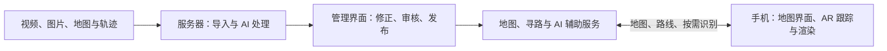

# DRD v0.2｜AI 辅助的校园地图与 AR 导航

文档状态：**讨论稿**。面向项目成员，用于讨论产品与技术设计。各部分均可继续修改；“候选方案”不代表已经决定采用。

## 1．产品目标与范围

帮助第一次进入复杂校园楼宇的人理解楼层、区域和通路之间的关系，选择路线，并通过手机 AR 指引到达目的地。

产品包含三个核心部分：

- **地图构建**：导入素材，辅助生成并审核建筑、楼层、标识和通路。
- **路线规划**：处理入口、楼梯、连廊等复杂连接，比较不同路线。
- **AR 导航**：将路线和转向提示放入摄像头画面，并与实际空间对齐。

AI 用于提高导入效率、辅助位置判断和丰富导航提示。

| 当前明确的需求 | 尚待讨论的设计 |
| --- | --- |
| 主体是地图与导航，AR 属于核心目标 | 客户端框架与 AR 实现方式 |
| 允许联网，后端可以部署在服务器 | 定位、地图对齐与楼层判断方法 |
| AI 可以在服务器运行或调用服务 | 模型及接入方式 |
| 优先考虑 Android | 寻路算法、路线评价与排序 |
| 前期使用模拟素材，无需现在采集校园视频 | 视频导入的自动化程度 |

离线能力可以以后加入。Unity、Kotlin 和手机端部署 AI 均不作为当前前提。

## 2．切题因素：辨路成本

项目关注的是：**入口难认、楼梯去向不清、区域连接难理解时，人需要付出多少额外判断与行动。**

例如，目的地明明在一层，却需要先上到二层，经连廊进入另一栋楼，再下到一层。普通平面地图很难说明这个过程。

地图需要标出：

| 因素 | 地图中的表达 | 可观察的结果 |
| --- | --- | --- |
| 入口容易混淆 | 入口名称、特征、进入后所属区域 | 选错入口次数 |
| 楼梯去向不清 | 起止楼层、连接区域、出口提示 | 确认方向所需时间 |
| 连廊关系难理解 | 区域连接与完整跨层过程 | 走错与折返距离 |
| 不同来向看到的信息不同 | 与接近方向对应的标识和提示 | 不同来向下的判断差异 |

三维地图和 AR 用来呈现这些关系、减少辨认负担。**切题证据来自这些因素怎样影响路线选择与使用行为。**

停顿、错误入口和折返的统计规则需要在测试前统一；模拟结果与校园实测结果分别标注。

## 3．使用流程

### 地图维护者

```text
导入视频、图片、楼层图及可选采集轨迹
→ AI 提取标识与地图候选
→ 查看来源、修正楼层和通路
→ 审核地图
→ 发布版本
```

维护界面应同时展示来源素材和地图草稿，让维护者知道某个标签或连接来自哪里。

普通视频未必包含可靠的相机位置。缺少位姿数据时，可以先完成标识识别和素材整理；精确地图与通路关系需要额外数据或人工确认。

### 导航使用者

```text
选择目的地
→ 确认当前位置与楼层
→ 完成地图与 AR 坐标对齐
→ 比较路线
→ 跟随地图和 AR 提示
→ 偏离或定位不确定时重新确认
```

手机收起后保留步骤提示；重新打开时检查跟踪与对齐状态。持续口袋定位仍属于待研究能力。

## 4．地图、路线与核心算法

地图需要保存：

- **空间结构**：建筑、区域、楼层。
- **导航节点**：入口、岔路、楼梯端点、连廊出口、目的地。
- **通路连接**：方向、长度、连接类型、通行状态与审核状态。
- **辨路信息**：容易混淆的原因、观察来向、标识证据和导航提示。

空间上靠近的两个点不一定连通。楼梯和连廊必须明确连接到哪个区域、哪个楼层。

已有模拟案例可用于讨论：

| 路线 | 过程 | 模拟长度 | 设计条件 |
| --- | --- | ---: | --- |
| 跨层捷径 | A1 → A2 → 连廊 → B2 → B1 | 41.37 m | 三处需要辨认的连接 |
| 地面绕行 | A1 → 地面通道 → B1 | 44.00 m | 一处需要辨认的连接 |

这些是模拟条件，后续可以调整。它们用于观察：当路线只稍微变长，但更容易理解时，使用者是否会改变选择。

**算法暂不冻结。**

| 设计问题 | 当前候选 |
| --- | --- |
| 基础寻路 | Dijkstra 或 A* |
| 提供不同路线 | 多候选路径算法 |
| 比较路线 | 分别展示距离、跨层过程、辨路因素 |
| 个性化推荐 | 根据偏好筛选，或采用多目标排序 |
| 偏离后的处理 | 更新起点并重新规划 |

需要先决定“路线好坏如何评价”，再决定具体算法。当前不规定固定权重、候选数量或绕行比例，也不把一个复杂岔路直接换算成未经测量的固定秒数。

## 5．系统架构与技术候选

建议采用**服务器处理地图、AI 与路线；手机负责交互和 AR 显示**的分工。



| 模块 | 主要职责 | 当前候选 |
| --- | --- | --- |
| 管理前端 | 素材导入、地图编辑、证据查看、审核发布 | React／TypeScript |
| 手机客户端 | 地图、路线比较、摄像头、AR、位置确认 | 待选 |
| 地图服务 | 地图版本、节点、通路、标识 | Python／FastAPI |
| 寻路服务 | 路线计算、比较、重算 | 算法待选 |
| AI 服务 | OCR、图像理解、提示生成、位置辅助 | 服务器模型或外部服务 |
| 存储 | 素材、地图版本、处理记录 | 数据库＋文件存储 |

导入等耗时任务建议交给独立 Worker，接口返回任务状态。

客户端可以评估两条路线：

| 候选 | 可复用的基础 | 需要验证的部分 |
| --- | --- | --- |
| **Android ARCore Java** | 官方提供摄像头、空间跟踪和渲染示例 | Android 集成、地图坐标对齐、导航渲染 |
| **WebXR＋TypeScript** | 浏览器中的 AR 能力 | 实际设备支持、相机数据访问、锚点能力及 APK 承载 |

ARCore 官方同时提供 Java 和 Kotlin 示例，因此不必先把 Kotlin 当作必选语言。[Android 示例](https://developers.google.com/ar/develop/java/quickstart) WebXR 也是可评估路径，但能力依赖设备与浏览器，需要实际验证。[WebXR 文档](https://developers.google.com/ar/develop/webxr)

**建议先验证官方 Java 示例在演示手机上的跟踪和坐标对齐能力，再做客户端选型。**Unity 可以参与比较，但不作为默认方案。

联网之后，手机仍需要持续更新摄像头位姿和空间画面。服务器可以按需识别关键帧、辅助定位；返回结果需要携带时间、会话和地图版本，避免把延迟返回的位置当作当前位置。

## 6．AI 的作用与边界

| 阶段 | AI 可以承担的工作 | 结果如何使用 |
| --- | --- | --- |
| 导入 | 识别门牌、楼层、区域名称和指示牌 | 生成可修改的标签与关联候选 |
| 地图整理 | 提取空间关系、提示矛盾或缺失信息 | 交由维护者审核 |
| 导航使用 | 识别关键画面中的标识，辅助确认区域或楼层 | 结合当前位置和地图判断 |
| 导航说明 | 根据已审核路线生成上下文提示 | 提示应能追溯到地图事实 |

例如：

> “目标在 B 区一层。先从当前楼梯上到二层，经连廊进入 B 区，再从 B 侧楼梯下楼。”

模型可以在服务器运行，也可以调用现成服务。具体方案取决于识别效果、响应速度、成本与接入条件。

可通行连接必须有证据并经过审核；最终路线由地图数据和寻路算法约束。

相近项目已有 AR 导航和 AI 建图能力，例如 [ARIndoorNavigation](https://github.com/FireDragonGameStudio/ARIndoorNavigation) 与 [Pointr MapScale](https://www.pointr.tech/solutions/location-based-engagement/mapscale)。我们的计划差异集中在**素材导入与可追溯审核、复杂跨层解释、辨路成本比较**，收益需要通过实验验证。

## 7．验证与验收

| 验收对象 | 需要证明的行为 |
| --- | --- |
| 地图流程 | 素材可以导入、修正、审核、发布并在手机加载 |
| 跨层寻路 | 路线正确经过楼梯和连廊；关闭通路后能改道或报告不可达 |
| **真实 AR** | 手机摄像头中的路径与已知地图坐标对齐，移动和转动手机后仍处于正确空间位置 |
| 跟踪恢复 | 丢失跟踪时停止确定性空间指引；恢复或重新对齐后仍对应已知参照位置 |
| AI 功能 | 实际处理样例，能查看识别来源、结果和修正记录 |
| 切题效果 | 能比较路线的辨路因素，并记录判断时间、错误选择和折返 |

### 模拟与真实验证的分工

复杂建筑结构、跨层路线和辨路实验可以先在模拟场景中完成。手机 AR 可以在一小段已知坐标的环境中验证，无需先采集校园素材。

模拟行走不能替代真实摄像头 AR 验收；小范围 AR 验证也不能直接宣称整栋真实楼宇导航已经完成。定位精度、响应延迟和性能阈值在设备验证后确定。

效果实验包括：

- **导入效率**：人工录入与 AI 辅助修正比较总耗时，最终地图正确程度保持一致。
- **导航体验**：基础提示与上下文提示在等价场景中比较，控制路线长度、标识条件和使用者熟悉程度。

## 8．下一轮需要讨论的设计问题

1. AR 客户端选型，以及演示设备的支持情况。
2. 初始地图对齐、重新定位和楼层确认。
3. 辨路因素如何记录，怎样影响路线推荐。
4. 视频导入需要哪些额外数据，自动化做到什么程度。
5. 使用阶段的 AI 接入方式与上传粒度。
6. 精度、延迟和导航效果的验收标准。

以上均保留修改空间，尤其是导航模型、核心算法和技术栈。
