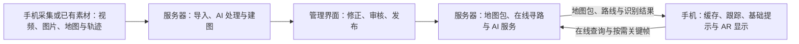

# DRD v0.3｜AI 辅助的校园地图与 AR 导航

文档状态：**讨论稿**。面向项目成员，用于讨论产品与技术设计。各部分均可继续修改；“候选方案”不代表已经决定采用。

## 1．产品目标与范围

帮助第一次进入复杂校园楼宇及室外通行区域的人理解楼层、地形、区域和通路之间的关系，选择路线，并通过手机 AR 指引到达目的地。

产品包含三个核心部分：

- **地图构建**：导入素材，辅助生成并审核建筑、楼层、标识和通路。
- **路线规划**：处理入口、楼梯、连廊等复杂连接，比较不同路线。
- **AR 导航**：将路线和转向提示放入摄像头画面，并与实际空间对齐。

AI 用于提高导入效率、辅助位置判断和丰富导航提示。

| 当前明确的需求 | 尚待讨论的设计 |
| --- | --- |
| 主体是地图与导航，AR 属于核心目标 | 定位与地图空间对齐的实现 |
| 允许联网，后端可以部署在服务器 | 定位、地图对齐与楼层判断方法 |
| AI 可以在服务器运行或调用服务 | 模型及接入方式 |
| 管理网页使用 Vite 构建，采用 Material Design 3（MD3） | 前端框架及可复用组件库 |
| 手机客户端采用 Java＋ARCore 原生 Android，复用 MD3 界面组件 | 具体组件库、跟踪恢复及地图坐标对齐 |
| 后端接口采用 Python＋FastAPI，导航计算由 C++ 内核承担 | 内核适配、任务执行与端到端性能验证 |
| 地图导入阶段，手机负责素材采集与上传；服务器负责地图处理 | 采集数据格式及位姿可靠性 |
| 保留有限离线基础导航，先支持已下载路线的断网延续 | 手机本地寻路、离线起始定位与恢复的集成方式 |
| 优先考虑 Android；导航总体方案已获认可 | 路线类别的具体评价顺序与参数校准 |
| 前期使用模拟素材，无需现在采集校园视频 | 视频导入的自动化程度 |

离线能力分层推进：先缓存地图、路线与基础提示，在本地跟踪和对齐有效时继续当前导航；再接入可复用的手机本地寻路，支持已下载区域中的目的地选择与重规划。完整离线 AI 与自动重定位不作为首版前提。Unity、Kotlin 和手机端部署 AI 均不作为当前前提。

## 2．切题因素：辨路成本

项目关注的是：**入口难认、楼梯去向不清、区域连接难理解时，人需要付出多少额外判断与行动。**

例如，目的地明明在一层，却需要先上到二层，经连廊进入另一栋楼，再下到一层。普通平面地图很难说明这个过程。

地图需要标出：

| 因素 | 地图中的表达 | 可观察的结果 |
| --- | --- | --- |
| 入口容易混淆 | 入口名称、特征、进入后所属区域 | 选错入口次数 |
| 楼梯去向不清 | 起止楼层、连接区域、出口提示 | 确认方向所需时间 |
| 连廊关系难理解 | 区域连接与完整跨层过程 | 走错与折返距离 |
| 不同来向看到的信息不同 | 与接近方向对应的标识和提示 | 不同来向下的判断差异 |

三维地图和 AR 用来呈现这些关系、减少辨认负担。**切题证据来自这些因素怎样影响路线选择与使用行为。**

停顿、错误入口和折返的统计规则需要在测试前统一；模拟结果与校园实测结果分别标注。

## 3．使用流程

### 地图维护者

地图导入阶段的分工已确认：手机负责采集与上传视频、图片及可用的轨迹、相机信息；服务器承担 AI 分析、几何重建或地图草稿生成、路网生成与校验。录制编码和为采集位姿所需的基础跟踪属于手机的必要采集处理，不属于手机端建图或 AI 分析。

```text
导入视频、图片、楼层图及可选采集轨迹
→ AI 提取标识与地图候选
→ 查看来源、修正楼层和通路
→ 审核地图
→ 发布版本
```

维护界面应同时展示来源素材和地图草稿，让维护者知道某个标签或连接来自哪里。

普通视频未必包含可靠的相机位置。缺少位姿数据时，可以先完成标识识别和素材整理；精确地图与通路关系需要额外数据或人工确认。

### 导航使用者

```text
加载预置或已下载的地图包
→ 选择目的地
→ 确认当前位置与楼层
→ 完成地图与 AR 坐标对齐
→ 比较路线
→ 跟随地图和 AR 提示
→ 偏离或定位不确定时重新确认
```

手机收起后保留步骤提示；重新打开时检查跟踪与对齐状态。持续口袋定位仍属于待研究能力。

地图包包含版本一致的路网、显示几何、目的地、基础提示、定位参照和通行规则参数，保存到手机后可再次打开。离线起始定位与地图对齐需要本地可用的方法；只有手动选定起点，不能代替精确 AR 所需的位置与方向对齐。离线只使用下载时的通行状态，无法自动获知之后的封路或电梯停运。

## 4．地图、路线与核心算法

完整导航设计见 [校园室内外 AR 导航后端设计 v1](NAVIGATION_DESIGN.md)。总体方案已获认可，覆盖多出口广场、地形起伏、混合路面、跨层设施、通行限制与动态状态；路线评价细则继续讨论，尚未实现或完成校园实测。

推荐采用 **Recast／Detour 可通行几何＋稀疏有向状态图＋Boost.Graph Dijkstra＋独立约束与偏好规则**。NavMesh 将开放区域划分成相邻可走面，出口接入所在面；不预计算全部出口对。楼梯、电梯、门口、连廊、过街接口等作为明确连接，投影重叠或空间靠近不自动连通。

地图保存空间与楼层身份、可走面及障碍、三维路径和高度剖面、材质与平整度、净宽与阶差、方向与通行许可、设施状态，以及来向相关的辨路证据。海拔与楼层分开；起终点同高仍可能存在累计爬升。石板与草地混合小路分段或标明混合／未知，不能默认整片草地允许通行。

| 设计问题 | 本轮完整提案 |
| --- | --- |
| 基础寻路 | 使用非负代价的 Dijkstra；A* 在证明有效下界并测得收益后再启用 |
| 开放区域 | 按局部网格接口搜索，处理孔洞、围栏开口、地形与材质边界；几何整理后重新复核 |
| 路线评价 | 时间、步行升降、台阶、路面、辨路及证据；步行与机械升降分开，物理指标和排序代价分别保存 |
| 通行限制 | 硬禁止先过滤，软偏好用于排序；关键属性未知时不声称符合严格条件 |
| 多方案 | 后端支持各类方案；前端通过配置决定展示类型和条数，先合并相同路线，再应用展示上限；硬限制作用于所有方案 |
| 跨层设施 | 电梯保存登梯、梯内停靠层和出梯状态，同次乘坐只计一次候梯；后期加入上下课峰段的可登梯等待估计；转换附动作 |
| 偏航与状态变化 | 使用确定版本的地图、规则与状态快照重新规划；新增围挡同时处理面内几何 |
| AR 输出 | 按空间和楼层分段的三维折线、设施动作、基础提示、地图与坐标变换版本 |

先处理硬限制，再按可解释代价比较路线。“无楼梯”不等同轮椅可达；最大坡度、净宽等依据具体能力和可靠地图事实检查，不设置未经核实的统一阈值。辨路评分不是已经测得的固定停顿秒数。

当前评价提案分别生成预计较快、行走较短、少爬升、少下行、少台阶、较平整、易辨认及少步行升降方案：先比较各类别主指标，再比较预计耗时，具体顺序尚待确认。乘电梯的升高不计作步行爬升，候梯仍计入预计时间。卡片说明相对较快方案的距离、时间及负担差异；指标缺失时说明无法可靠比较，不将未知值设为零，不称某条路线为已校准的“综合最佳”。支持各类别不等于枚举所有路径；几何整理后重算指标并合并重复方案。

用户确认学校电梯在上下课时段等待明显增加，后期候梯模型需覆盖普通／上下课情景，并区分梯组、楼层和方向。等待包括排队及满员后继续等下一轮，计算到实际能够登梯为止；具体时长、峰段及波动需要数据，不冒充实时预测。v1 仍按请求级固定情景快照计算；后期按预计抵达候梯厅时刻计价时，需另行验证时间相关寻路。前端展示类型、数量上限及顺序独立配置，默认值后续确定；减少展示不改变后端的类别支持、通行限制或指标计算。

已有模拟案例继续保留用于比较：

| 路线 | 过程 | 模拟长度 | 设计条件 |
| --- | --- | ---: | --- |
| 跨层捷径 | A1 → A2 → 连廊 → B2 → B1 | 41.37 m | 三处需要辨认的连接 |
| 地面绕行 | A1 → 地面通道 → B1 | 44.00 m | 一处需要辨认的连接 |

这些是可调整的模拟条件，用于观察路线稍长但更容易理解时的选择变化。网格分辨率、物理限制、速度和偏好系数保留来源与参数版本，实施时校准。图上最优与连续空间全局最优、模型估计与真实体验分别说明；尚未进行性能和校园效果实测。

## 5．系统架构与技术候选

分工按阶段确定：**地图导入由手机采集与上传，服务器完成 AI 分析、地图与路网生成、校验和发布；导航使用由手机维护缓存、跟踪、进度、基础提示与 AR 显示，联网时获取服务器增强能力。**

当前完整导航提案先在服务器执行。离线先支持已下载路线的延续；手机本地基础寻路是后续接入目标，优先评估复用同一导航内核和规则。未完成本地寻路前，断网后不承诺重新选择目的地或重规划。



| 模块 | 主要职责 | 当前方案或候选 |
| --- | --- | --- |
| 管理前端 | 素材导入、地图编辑、证据查看、审核发布 | Vite＋MD3 已确定；前端框架与组件库待选 |
| 手机客户端 | 地图包缓存、路线跟随、摄像头、AR、位置确认；逐步接入本地寻路 | Java＋ARCore 原生 Android 已确定；复用 MD3，具体组件库待选 |
| 地图服务 | 地图版本、节点、通路、标识与地图包发布 | Python＋FastAPI 已确定；导航内核适配待实现 |
| 寻路服务 | 在线路线计算、比较、重算；评估复用内核到手机 | Recast／Detour＋Boost.Graph（完整提案） |
| AI 服务 | OCR、图像理解、提示生成、位置辅助 | 服务器模型或外部服务 |
| 存储 | 素材、地图版本、处理记录 | 数据库＋文件存储 |

Python＋FastAPI 负责上传、地图维护、版本查询及任务状态接口，通过适配层调用 C++ 导航内核。几何处理、路线搜索与指标计算留在内核；已发布地图加载后供查询复用，避免逐边跨语言调用或每次查询重新传递整张地图。适配层的数据格式、内存释放、错误返回和并发安全仍需实现，尚未完成端到端性能实测。

导入、AI 分析与建图等耗时任务交给独立 Worker，接口返回任务编号与状态。同步原生调用也需安排执行，避免阻塞其他接口请求；异步接口语法本身不能加速重计算。

管理网页使用 Vite 构建，手机采用 Java＋ARCore 原生 Android；两端沿用 MD3 界面规范并分别复用对应平台组件。手机通过 HTTP 与服务器交换地图、路线和任务数据，客户端语言不要求后端使用同一语言。

手机首版界面覆盖目的地选择、路线比较、地图／AR 导航、位置确认与跟踪恢复，围绕 Java ARCore 基础接入现成 MD3 组件，具体组件库待选。空间路径与箭头由 AR 渲染层处理，界面组件负责常规操作与提示。

手机本地寻路需要客户端可用的实现与规则。复用 C++ 内核到 Android 仍需处理构建、调用接口、地图加载和结果一致性，不能视为已经完成或没有额外成本。首版地图更新可采用预置或整包下载与替换，避免同时维护两套不同的导航规则；导航使用确定版本的数据。

客户端路线已确认采用 Java＋ARCore。官方 Java 示例提供摄像头、空间跟踪与基础渲染，可作为集成基础；地图坐标对齐、导航渲染与跟踪恢复仍需实现并在演示手机验证。选型确认不代表已经完成真实 AR 导航验收。[Android 示例](https://developers.google.com/ar/develop/java/quickstart)

联网之后，手机仍需要持续更新摄像头位姿和空间画面。服务器可以按需识别关键帧、辅助定位；返回结果需要携带时间、会话和地图版本，避免把延迟返回的位置当作当前位置。

## 6．AI 的作用与边界

| 阶段 | AI 可以承担的工作 | 结果如何使用 |
| --- | --- | --- |
| 导入 | 识别门牌、楼层、区域名称和指示牌 | 生成可修改的标签与关联候选 |
| 地图整理 | 提取空间关系、提示矛盾或缺失信息 | 交由维护者审核 |
| 导航使用 | 识别关键画面中的标识，辅助确认区域或楼层 | 结合当前位置和地图判断 |
| 导航说明 | 根据已审核路线生成上下文提示 | 提示应能追溯到地图事实 |

例如：

> “目标在 B 区一层。先从当前楼梯上到二层，经连廊进入 B 区，再从 B 侧楼梯下楼。”

模型可以在服务器运行，也可以调用现成服务。具体方案取决于识别效果、响应速度、成本与接入条件。

可通行连接必须有证据并经过审核；最终路线由地图数据和寻路算法约束。

基础步骤提示随已审核地图和路线保存。联网 AI 可以增强识别、位置确认和说明；缺少在线增强时，已具备本地定位与对齐条件的基础导航仍应可用。

相近项目已有 AR 导航和 AI 建图能力，例如 [ARIndoorNavigation](https://github.com/FireDragonGameStudio/ARIndoorNavigation) 与 [Pointr MapScale](https://www.pointr.tech/solutions/location-based-engagement/mapscale)。我们的计划差异集中在**素材导入与可追溯审核、复杂跨层解释、辨路成本比较**，收益需要通过实验验证。

## 7．验证与验收

| 验收对象 | 需要证明的行为 |
| --- | --- |
| 地图流程 | 素材可以导入、修正、审核、发布并在手机加载 |
| 跨层寻路 | 路线正确经过楼梯和连廊；关闭通路后能改道或报告不可达 |
| **真实 AR** | 手机摄像头中的路径与已知地图坐标对齐，移动和转动手机后仍处于正确空间位置 |
| 跟踪恢复 | 丢失跟踪时停止确定性空间指引；恢复或重新对齐后仍对应已知参照位置 |
| 有限离线 | 预先保存地图、路线和基础提示后，断网且跟踪与对齐有效时可继续当前导航；不以此声称已经支持离线起始定位或重规划 |
| 本地寻路扩展 | 接入手机内核后，再验证已下载区域中的离线目的地选择、约束与偏好规则、偏离重算及离线定位前提 |
| AI 功能 | 实际处理样例，能查看识别来源、结果和修正记录 |
| 切题效果 | 能比较路线的辨路因素，并记录判断时间、错误选择和折返 |

### 模拟与真实验证的分工

复杂建筑结构、跨层路线和辨路实验可以先在模拟场景中完成。手机 AR 可以在一小段已知坐标的环境中验证，无需先采集校园素材。

模拟行走不能替代真实摄像头 AR 验收；小范围 AR 验证也不能直接宣称整栋真实楼宇导航已经完成。定位精度、响应延迟和性能阈值在设备验证后确定。

效果实验包括：

- **导入效率**：人工录入与 AI 辅助修正比较总耗时，最终地图正确程度保持一致。
- **导航体验**：基础提示与上下文提示在等价场景中比较，控制路线长度、标识条件和使用者熟悉程度。

## 8．逐项讨论清单

按用户提供的清单顺序推进，当前进入第 3 项。已在其他会话讨论的条目保留其已确认决定与待解决问题；“已有设计”不代表完成实现或实测。

1. **导航后端算法**：总体方案已获认可；实现、性能及手机本地内核复用待验证。
2. **路线评价与推荐**：已讨论各类方案、上下课候梯及可配置展示；具体评价顺序、辨路／体力／路面参数待确认和校准。
3. **地图与路网模型**：当前讨论。沿用已有空间、几何与通行对象，细化来向相关的辨路难度、跨层连接和供 AR 使用的路线几何。
4. **手机客户端与 AR 实现**：Java＋ARCore 原生 Android 已确定；摄像头、跟踪、地图与渲染集成、手机本地寻路及真实设备验证待完成。
5. **定位与地图坐标对齐**：确定起始位置、朝向、空间参照及地图到 AR 的变换；包括离线起始定位的前提。
6. **楼层判断与跟踪恢复**：上下楼和乘梯后的楼层确认、失去定位的识别与重新对齐；口袋定位仍待研究。
7. **素材导入与建图**：视频、图片、楼层图及可选轨迹的输入要求，自动化程度和需人工补齐的部分。
8. **AI 模型与接入流程**：OCR、图像理解、提示生成的模型与部署，导航上传粒度、调用时机及延迟结果处理。
9. **三维地图生成与呈现**：结构来源、渲染方式，以及楼层、连廊和完整跨层路线的展示。
10. **前端设计语言与交互规范**：MD3 已确定；具体组件、路线比较、地图／AR 切换及定位不确定时的交互仍需细化。
11. **地图存储、发布与版本一致性**：素材证据关联、草稿和发布快照、地图包以及路线／AI 结果的版本一致性；与对应会话的存储讨论衔接。

精度、延迟和导航效果的验收标准，以及模拟与校园实测的区别，贯穿上述各项，不另行改变本清单的讨论顺序。未确认的方案继续保留修改空间。
