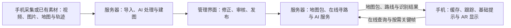

# DRD v1.0｜AI 辅助的校园地图与 AR 导航

文档状态：**开发设计基线**，2026-10-12。用户授权独立完成选型与行为设计；本文件规定首版范围、数据、接口、状态和验收目标，供后续开发直接引用。设计完成不代表代码、部署或校园实测完成。实测结果、模型估计和模拟数据必须分别标记。

本文件负责产品与跨模块契约；[导航设计](NAVIGATION_DESIGN.md)负责内核细节，两者须保持一致。后续修改需同步受影响的接口、数据版本和验收行为，不能由实现者默默改变范围。所有版本依赖在首次实现时锁定到兼容稳定版本，不使用移动分支作为构建依赖。

## 1．产品目标与范围

帮助第一次进入复杂校园楼宇及室外通行区域的人理解楼层、地形、区域和通路之间的关系，选择路线，并通过手机 AR 指引到达目的地。

产品包含三个核心部分：

- **地图构建**：导入素材，辅助生成并审核建筑、楼层、标识和通路。
- **路线规划**：处理入口、楼梯、连廊等复杂连接，比较不同路线。
- **AR 导航**：将路线和转向提示放入摄像头画面，并与实际空间对齐。

AI 用于提高导入效率、辅助位置判断和丰富导航提示。

| 开发基线 | 实现与核验责任 |
| --- | --- |
| 主体是地图与导航，AR 属于核心目标 | 固定图像参照＋ARCore 局部跟踪，小范围真实 AR 验收 |
| 允许联网，后端部署在单台服务器 | 定位、坐标、楼层和版本行为按第 8、9 节实现 |
| AI 采用服务器 CPU OCR＋第三方视觉增强 | 明确模型、输出约束、预算及失败降级，见第 6 节 |
| 管理网页采用 Vite＋Vue 3＋TypeScript＋Vuetify 3 MD3 blueprint | 地图编辑与三维预览使用 Three.js，见第 10 节 |
| 手机采用 Java＋XML Views＋Material Components＋ARCore 原生 Android | AR Optional；兼容设备上的真实 AR 是必需验收，见第 8 节 |
| 后端接口采用 Python＋FastAPI，导航计算由 C++ 内核承担 | 内核适配、任务执行与端到端性能验证 |
| 首版存储采用 SQLite＋服务器文件目录＋版本化 ZIP 地图包 | 字段、兼容格式及完整发布切换按第 9 节实现 |
| 导入任务采用一个独立 Python Worker＋SQLite 任务表 | 具体处理步骤与输入要求、运行实现及恢复验证 |
| 导入阶段手机采集上传，服务器处理；人工校准几何＋AI 标签候选 | 输入要求和自动化边界按第 6、11 节实现 |
| 首版离线延续缓存路线；v1.1 使用同 C++ 内核经 JNI 本地重规划 | 本地图像参照可用于重新对齐，但不能替代未接入的寻路能力 |
| 导航使用 Recast／Detour＋状态图＋Boost.Graph Dijkstra | 8 类固定比较规则，参数与真实效果仍须校准验证 |
| 前期使用模拟素材，无需现在采集校园视频 | 视频导入的自动化程度 |

离线能力分层推进：v1 缓存地图、选定路线、步骤、基础提示和图像参照，在本地跟踪与对齐有效时延续该路线；v1.1 经 JNI 接入同一 C++ 内核及规则，在已下载区域本地选目的地与重规划。完整离线 AI、无参照自动重定位、持续口袋定位和自动精确视频重建不属于 v1。手机使用 Java，不引入 Unity、Kotlin 或手机端 AI 模型。

## 2．切题因素：辨路成本

项目关注的是：**入口难认、楼梯去向不清、区域连接难理解时，人需要付出多少额外判断与行动。**

例如，目的地明明在一层，却需要先上到二层，经连廊进入另一栋楼，再下到一层。普通平面地图很难说明这个过程。

地图需要标出：

| 因素 | 地图中的表达 | 可观察的结果 |
| --- | --- | --- |
| 入口容易混淆 | 入口名称、特征、进入后所属区域 | 选错入口次数 |
| 楼梯去向不清 | 起止楼层、连接区域、出口提示 | 确认方向所需时间 |
| 连廊关系难理解 | 区域连接与完整跨层过程 | 走错与折返距离 |
| 不同来向看到的信息不同 | 与接近方向对应的标识和提示 | 不同来向下的判断差异 |

三维地图和 AR 用来呈现这些关系、减少辨认负担。**切题证据来自这些因素怎样影响路线选择与使用行为。**

停顿、错误入口和折返的统计规则需要在测试前统一；模拟结果与校园实测结果分别标注。

## 3．使用流程

### 地图维护者

地图导入阶段的分工已确认：手机负责采集与上传视频、图片及可用的轨迹、相机信息；服务器承担 AI 分析、几何重建或地图草稿生成、路网生成与校验。录制编码和为采集位姿所需的基础跟踪属于手机的必要采集处理，不属于手机端建图或 AI 分析。

采集交接已确认采用原始视频／照片＋JSON 描述文件＋可选位姿轨迹与相机参数。描述文件记录素材标识、时间和已知建筑／楼层，不确定信息留空。位姿轨迹保存位置与朝向，通过时间戳对应拍摄画面，并注明坐标系；不能直接把本次 AR 的局部坐标当成校园坐标。首版素材先在手机本地保存，再手动上传。

```text
导入视频、图片、楼层图及可选采集轨迹
→ AI 提取标识与地图候选
→ 查看来源、修正楼层和通路
→ 审核地图
→ 发布版本
```

维护界面应同时展示来源素材和地图草稿，让维护者知道某个标签或连接来自哪里。

普通视频未必包含可靠的相机位置。缺少位姿数据时，可以先完成标识识别和素材整理；精确地图与通路关系需要额外数据或人工确认。

### 导航使用者

```text
加载预置或已下载的地图包
→ 选择目的地
→ 确认当前位置与楼层
→ 完成地图与 AR 坐标对齐
→ 比较路线
→ 跟随地图和 AR 提示
→ 偏离或定位不确定时重新确认
```

手机收起后保留步骤提示；重新打开时检查跟踪与对齐状态。持续口袋定位仍属于待研究能力。

地图包包含版本一致的路网、显示几何、目的地、基础提示、定位参照和通行规则参数，保存到手机后可再次打开。离线起始定位与地图对齐需要本地可用的方法；只有手动选定起点，不能代替精确 AR 所需的位置与方向对齐。离线只使用下载时的通行状态，无法自动获知之后的封路或电梯停运。

## 4．地图、路线与核心算法

完整导航设计见 [校园室内外 AR 导航后端设计 v1](NAVIGATION_DESIGN.md)。方案覆盖多出口广场、地形起伏、混合路面、跨层设施、通行限制与动态状态；类别与接口已收敛，尚未实现或完成校园实测。

采用 **Recast／Detour 可通行几何＋稀疏有向状态图＋Boost.Graph Dijkstra＋独立约束与偏好规则**。NavMesh 将开放区域划分成相邻可走面，出口接入所在面；不预计算全部出口对。楼梯、电梯、门口、连廊、过街接口等作为明确连接，投影重叠或空间靠近不自动连通。

地图保存空间与楼层身份、可走面及障碍、三维路径和高度剖面、材质与平整度、净宽与阶差、方向与通行许可、设施状态，以及来向相关的辨路证据。海拔与楼层分开；起终点同高仍可能存在累计爬升。石板与草地混合小路分段或标明混合／未知，不能默认整片草地允许通行。

| 设计问题 | 开发基线 |
| --- | --- |
| 基础寻路 | 使用非负代价的 Dijkstra；A* 在证明有效下界并测得收益后再启用 |
| 开放区域 | 按局部网格接口搜索，处理孔洞、围栏开口、地形与材质边界；几何整理后重新复核 |
| 路线评价 | 时间、步行升降、台阶、路面、辨路及证据；步行与机械升降分开，物理指标和排序代价分别保存 |
| 通行限制 | 硬禁止先过滤，软偏好用于排序；关键属性未知时不声称符合严格条件 |
| 多方案 | 后端支持各类方案；前端通过配置决定展示类型和条数，先合并相同路线，再应用展示上限；硬限制作用于所有方案 |
| 跨层设施 | 电梯保存登梯、梯内停靠层和出梯状态，同次乘坐只计一次候梯；后期加入上下课峰段的可登梯等待估计；转换附动作 |
| 偏航与状态变化 | 使用确定版本的地图、规则与状态快照重新规划；新增围挡同时处理面内几何 |
| AR 输出 | 按空间和楼层分段的三维折线、设施动作、基础提示、地图／frame 版本与客户端请求关联 |

先处理硬限制，再按可解释代价比较路线。“无楼梯”不等同轮椅可达；最大坡度、净宽等依据具体能力和可靠地图事实检查，不设置未经核实的统一阈值。辨路评分不是已经测得的固定停顿秒数。

路线评价分别生成预计较快、行走较短、少爬升、少下行、少台阶、较平整、易辨认及少步行升降方案：每类使用第 12 节固定非负代价元组；搜索前固定证据子图与比较次序。乘电梯的升高不计作步行爬升，候梯仍计入预计时间。卡片说明相对较快方案的距离、时间及负担差异；指标缺失时说明无法可靠比较，不将未知值设为零，不称某条路线为已校准的“综合最佳”。支持各类别不等于枚举所有路径；几何整理后重算指标并合并重复方案。

用户确认学校电梯在上下课时段等待明显增加，后期候梯模型需覆盖普通／上下课情景，并区分梯组、楼层和方向。等待包括排队及满员后继续等下一轮，计算到实际能够登梯为止；具体时长、峰段及波动需要数据，不冒充实时预测。v1 仍按请求级固定情景快照计算；后期按预计抵达候梯厅时刻计价时，需另行验证时间相关寻路。前端展示类型、数量上限及顺序独立配置，默认展示配置见第 12 节；减少展示不改变后端的类别支持、通行限制或指标计算。

已有模拟案例继续保留用于比较：

| 路线 | 过程 | 模拟长度 | 设计条件 |
| --- | --- | ---: | --- |
| 跨层捷径 | A1 → A2 → 连廊 → B2 → B1 | 41.37 m | 三处需要辨认的连接 |
| 地面绕行 | A1 → 地面通道 → B1 | 44.00 m | 一处需要辨认的连接 |

这些是可调整的模拟条件，用于观察路线稍长但更容易理解时的选择变化。网格分辨率、物理限制、速度和偏好系数保留来源与参数版本，实施时校准。图上最优与连续空间全局最优、模型估计与真实体验分别说明；尚未进行性能和校园效果实测。

### 地图与路网模型：实施契约

本节基于已确定的导航内核及 SQLite＋文件目录存储，规定对象、字段和构建流程；尚未编写对应代码。定位、接口、呈现和评价分别按第 8、9、10、12 节实施。

地图保存审核后的空间、通行关系、物理属性及证据，发布时生成寻路图和显示数据。管理端维护有实际含义的对象；细密 NavMesh 多边形、局部接口代表点和搜索状态由构建阶段生成。数据库中的入口 ID 与内核临时节点索引分别保存，重建网格不改变入口的身份。

#### 对象、字段与关联

同一对象跨修订沿用稳定 UUID 字符串；每个修订保存自己的对象记录，以 `(revision_id, id)` 标识具体内容。`MapRevision` 区分可编辑草稿和已发布快照；发布后的 `revision_id` 作为导航响应的 `map_version`。删除或拆分真实对象时保留旧版本，新增对象使用新 ID，不能把旧路线中的 ID 改指另一个入口。

| 对象 | 主要字段 | 关联和用途 |
| --- | --- | --- |
| `MapRevision` | `id`、`map_id`、`status`、`schema_version`、`frame_id`、`base_revision_id` | 归属一个校园地图，固定该修订的对象和坐标定义；发布快照不可原地改写 |
| `Level`／`Space` | 楼层的建筑归属、显示名称与可选参考高度；空间的 `level_id`、`kind`、边界几何 | 走廊、房间、大厅和室外区域各有空间身份；室外地面使用明确层身份，高度仍可连续起伏 |
| `RouteNode` | `space_id`、三维位置、`role`、可选 `portal_id`／`connector_id` | 只保存真实岔路、门口两侧、设施停靠口或目的地入口；可有多个角色，不把全部网格顶点当人工地图节点 |
| `Geometry` | `kind`、`frame_id`、文件或小型内嵌数据、尺寸／高度来源及误差 | 保存点、三维折线、带孔面边界或索引三角面；同一事实被寻路和显示数据引用 |
| `WalkSurface` | `space_id`、边界／高度几何、表面属性区域、审核状态 | 表达大厅和广场的可走面、障碍孔洞及异质路面；出口仅接入所在可走面 |
| `PathSegment` | `space_id`、`from_node_id`、`to_node_id`、`geometry_id`、方向、分段属性及通行规则 | 表达已知走廊或小路；双向通路由同一物理对象生成两个有向连接，分别计算上坡、下坡和来向费用 |
| `Portal` | 两侧 `RouteNode`、开口几何、净宽／阶差、方向和许可 | 同一个门保存两侧进入点，穿过门才转换空间；不能因为两侧坐标近而跳过门禁 |
| `Connector`／`ConnectorPort` | 设施类型、每个真实停靠口的节点／空间／楼层、连接顺序、方向、剖面及状态／候梯模型关联 | 楼梯、坡道、扶梯、电梯和过街设施；停靠口用子记录保存，仅连接实际允许到达的出口 |
| `Destination`／入口关联 | 名称、空间、一个或多个 `entry_node_id`、各入口条件 | 房间或建筑绑定可进入的入口集合；搜索终点为可用入口，不使用房间中心代替入口 |
| `DecisionTransition` | `at_node_id`、`incoming_ref`、`outgoing_ref`、辨路事实、`sign_ids` 与证据 | 费用绑定一次有实际意义的进入→离开转换；引用具体有向通行对象，而非所有网格拐点 |
| `Sign`／`Evidence` | 标识文本与位置、观察来向、可见性；素材 ID、视频时间／图片区域、测量来源、观测和审核信息 | 同一入口从不同方向看到的标识可不同；事实关联到具体对象及字段，来源文件单独保存 |
| `StateOverlay` | 目标对象或阻挡几何、状态、有效期、来源及 `state_version` | 封路、电梯停运等独立于地图发布版本；查询使用与该地图兼容的状态快照 |

`incoming_ref` 和 `outgoing_ref` 使用有限的明确结构：对象类型（路径／门户／设施）、对象 ID、起止端口和行进方向。它们引用语义对象，不能持久引用某次 NavMesh 构建的多边形编号。编译时将引用映射到相应的进入／离开状态边；没有实际岔路或转换的网格细分不产生额外决策费用。

#### SQLite 与几何文件的落地方式

主要对象、设施停靠口、目的地入口关联、证据关联和状态记录分别落入对应关系表。频繁筛选、连接和约束的字段使用普通列；小型坐标数组或分段属性可保存为有格式版本的 JSON，较大的三角面和构建后的网格放在文件目录，以资源 ID 引用。文件目录的物理路径不进入手机接口。

明确指向某张表的关联使用同修订的复合外键，例如路径端点 `(revision_id, from_node_id)` 指向节点表 `(revision_id, id)`；不得连接另一个地图修订的节点。为空间归属、路径两端、设施停靠口和目的地入口的关联建立所需索引。每个服务器数据库连接显式开启 `PRAGMA foreign_keys=ON`，不能假定外键自动生效；复合外键的被引用列须有对应主键或唯一约束。[SQLite 外键说明](https://www.sqlite.org/foreignkeys.html)

指向多个明确对象类型的有向引用、证据目标和状态目标，由发布／加载步骤检查类型、ID、修订和方向是否匹配；普通单表外键不能替代这项语义检查。初版使用本节固定类型及导航设计中的通行字段。

物理数值统一单位：距离、净宽、阶差和高度为米，时间为秒，坡度为有方向的比值。未知值使用 SQL `NULL`／JSON `null`，事实与模型估计分别标识。几何至少关联其坐标与高度证据；严格条件所需属性缺失时不能把审核标签理解为“所有属性已测量”。

#### 来向、混合路面与跨层连接

例如，同一入口从南侧接近能看到门牌，从北侧接近被柱子遮挡：入口保持一个 `Portal` 身份，分别保存相应有向转换的标识可见性和证据。实际提示引用该来向的事实，不给整个入口设置一个对所有方向都相同的难度值；是否将其判为困难以及具体系数仍按路线评价规则校准。

路径属性沿原三维折线的累计行走距离保存区间 `from_m`／`to_m`。石板、草地、缝隙、松软或瓶颈发生变化时划分区间；可走面的属性变化使用面内区域表达。发布时按必要边界切分几何和局部连接，并保留原对象与区间的映射。反向或从路段中间接入时，只累计实际经过的部分；重叠区域属性冲突交由审核，不能静默挑选较便宜的状态。

普通 `PathSegment` 的端点属于同一空间，跨空间必须经过 `Portal` 或 `Connector`。连廊可作为独立 `Space` 及可走面，两端通过门户接入建筑；桥上和桥下各有自己的空间身份。楼梯／坡道按实际剖面连接停靠口，正反方向单独计算升降。电梯的候梯、梯内停靠和出梯状态由停靠口及连接顺序生成，同次乘坐只计一次候梯；楼层显示名称不参与自动排序或推导连通性。

#### 从地图对象构建寻路数据

```text
固定已审核修订、坐标及构建配置
→ 可走面和高度几何生成 NavMesh
→ 真实节点接入局部可走面
→ 加入有向路径、门户及设施状态
→ 展开真实决策来向状态
→ 输出稀疏图、几何及原对象映射
```

几何与连接性检查在发布构建阶段执行：端点、空间、楼层和坐标一致；面边界与障碍合法；路径处于对应可走面并满足已知净空；跨空间和跨层有明确审核连接；入口真实可进入。没有连接的区域可作为独立连通分量保留，但不能发布一条跨越其间的虚假连接。平面图缺少可靠高度时先保留草稿，不用零高度伪造已对齐的三维导航数据。

开放面按局部相邻接口生成连接，出口多时仍使用已有稀疏网格方案。方向、标识来向和乘梯状态在 C++ 中展开，依据方案分别搜索；图边保存原对象／属性区间引用。Python 导出和调度数据，避免在每次查询逐边跨语言回调。C++ 内部可使用连续整数索引，发布文件另保存它们与稳定对象 ID 的映射。

基础几何、图和来源映射构建一次后作为只读快照加载复用。查询仅接入临时起终点、过滤通行限制并应用状态快照，临时节点不回写为永久地图对象。查询位置先确认空间和楼层，再吸附到相应可走面；不能直接选择全校园最近节点。

#### 发布格式与地图／AR 共用的路线

地图包使用 `manifest.json` 记录地图／修订 ID、`schema_version`、坐标定义、构建配置、各数据文件及其校验值。语义对象及小型几何使用 UTF-8 JSON；大型网格和寻路数据使用有明确格式头的二进制块。格式头包含格式版本、节点／边或网格数量、坐标布局、数值类型／字节序及所需内核构建标识，不直接保存 Boost 对象的进程内存布局。Detour 数据也需校验构建和格式兼容性，不能把内核文件等同于无需适配的 Android 通用格式；Detour 网格头自身含版本等字段。[Detour 网格头](https://recastnav.com/structdtMeshHeader.html)

地图事实采用米制校园坐标 `x` 东、`y` 北、`z` 上，源素材的局部坐标保存到校园坐标的变换及来源。发布几何转换到该版本的统一坐标；Recast 轴顺序由内核适配层处理。楼层身份与高度分别保存，不能按“二层＝固定几米”给整个校园补高度。

路线响应沿用导航接口的 `map_version`、`state_version`、规则／候梯模型版本，增加对应的 `frame_id`。每段包含 `segment_id`、`kind`（行走／设施转换）、空间及起止楼层、原对象和行进方向、地图坐标中的三维点列、实际行走累计距离和适用动作；指标在几何复核后计算。转换段可以关联多个空间，不能强行塞进单一楼层；乘梯段显示登梯／出梯动作，不作为竖井里的可步行折线。

二维地图将同一三维点列投影到当前空间／楼层显示，保留高度及跨层动作供完整路线查看。Java 客户端的地图与 AR 模块读取同一个路线结果；AR 在对齐有效时使用 `p_AR = T_AR_from_MAP × [x, y, z, 1]` 转换行走点列，变换带对应地图版本与对齐身份。显示端按渲染需要采样，不重新求一条路线，也不把采样点数量计入距离或辨路费用。

地图包版本、路线版本或对齐身份不匹配时，先重算路线或重新对齐再恢复空间指引；位置／对齐方法按第 8 节实现。本节定义共享数据契约，不把数据转换当作已解决定位精度。

## 5．系统架构与技术选择

分工按阶段确定：**地图导入由手机采集与上传，服务器完成 AI 分析、地图与路网生成、校验和发布；导航使用由手机维护缓存、跟踪、进度、基础提示与 AR 显示，联网时获取服务器增强能力。**

首版导航内核在服务器执行。离线先支持已下载路线的延续；手机本地基础寻路是后续接入目标，v1.1 经 JNI 复用同一 C++ 内核和规则。未完成本地寻路前，断网后不承诺重新选择目的地或重规划。

首版在开始导航或确需重算时请求服务器路线，AI 按需上传关键帧。服务器返回路线点列、动作、提示及版本；手机根据当前本地跟踪和有效地图对齐显示路线，不让每一帧 AR 显示等待服务器响应。



| 模块 | 主要职责 | 确定方案 |
| --- | --- | --- |
| 管理前端 | 素材导入、地图编辑、证据查看、审核发布 | Vite＋Vue 3＋TypeScript＋Vuetify 3 MD3 blueprint＋Three.js |
| 手机客户端 | 地图包缓存、路线跟随、摄像头、AR、位置确认；逐步接入本地寻路 | Java＋XML Views＋Material Components／Material3＋ARCore |
| 地图服务 | 地图版本、节点、通路、标识与地图包发布 | Python＋FastAPI 已确定；导航内核适配待实现 |
| 寻路服务 | 在线路线计算、比较、重算；评估复用内核到手机 | Recast／Detour＋状态图＋Boost.Graph Dijkstra 的 C++ 内核 |
| AI 服务 | OCR、图像理解、说明草稿、地标候选 | CPU PP-OCRv5 mobile＋百炼 qwen3-vl-plus |
| 导入任务处理 | 后台执行素材处理、进度查询、失败与中断恢复 | 一个独立 Python Worker＋SQLite 任务表已确定 |
| 存储 | 素材、地图版本、处理记录 | SQLite＋服务器文件目录＋版本化地图包已确定 |

Python＋FastAPI 负责上传、地图维护、版本查询及任务状态接口，通过适配层调用 C++ 导航内核。几何处理、路线搜索与指标计算留在内核；已发布地图加载后供查询复用，避免逐边跨语言调用或每次查询重新传递整张地图。适配层的数据格式、内存释放、错误返回和并发安全仍需实现，尚未完成端到端性能实测。

导入、AI 分析与建图等耗时任务采用独立 Python Worker＋SQLite 任务表，接口返回任务编号与状态。同步原生调用也需安排执行，避免阻塞其他接口请求；异步接口语法本身不能加速重计算。

管理网页使用 Vite 构建，手机采用 Java＋ARCore 原生 Android；两端沿用 MD3 界面规范并分别复用对应平台组件。手机通过 HTTP 与服务器交换地图、路线和任务数据，客户端语言不要求后端使用同一语言。

手机首版界面覆盖目的地选择、路线比较、地图／AR 导航、位置确认与跟踪恢复，围绕 Java ARCore 基础接入 Material Components／Material3，按第 8 节状态实施。空间路径与箭头由 AR 渲染层处理，界面组件负责常规操作与提示。

手机本地寻路需要客户端可用的实现与规则。v1.1 通过 JNI 复用 C++ 内核到 Android，仍需处理构建、调用接口、地图加载和结果一致性，不能视为已经完成或没有额外成本。首版地图更新可采用预置或整包下载与替换，避免同时维护两套不同的导航规则；导航使用确定版本的数据。

客户端路线已确认采用 Java＋ARCore。官方 Java 示例提供摄像头、空间跟踪与基础渲染，可作为集成基础；地图坐标对齐、导航渲染与跟踪恢复仍需实现并在演示手机验证。选型确认不代表已经完成真实 AR 导航验收。[Android 示例](https://developers.google.com/ar/develop/java/quickstart)

联网之后，手机仍需要持续更新摄像头位姿和空间画面。服务器可以按需识别关键帧、辅助定位；返回结果需要携带时间、会话和地图版本，避免把延迟返回的位置当作当前位置。

### 导入任务执行

首版已确认采用一个独立 Python Worker＋SQLite 任务表。API 与 Worker 分别作为独立进程启动；仅运行一个有效 Worker，串行处理导入任务。Worker 通过轮询领取任务，任务与输入素材引用持久保存。

| 接口 | 行为 |
| --- | --- |
| `POST /import-tasks` | 上传文件已完整保存后，提交素材标识、处理参数及适用的地图版本，创建等待任务并返回任务编号 |
| `GET /import-tasks/{task_id}` | 返回状态、当前阶段、可靠的处理计数及结果或错误摘要；管理网页定期查询 |
| `POST /import-tasks/{task_id}/retry` | 对失败或中断任务创建新任务并记录原任务编号，复用原始素材，保留旧任务及其失败信息 |

任务表保存任务编号、状态、阶段、输入素材引用、处理参数、适用的地图版本、创建／更新时间、结果引用、错误摘要及重试来源。状态为 `queued`（等待）、`running`（处理中）、`succeeded`（成功）、`failed`（失败）和 `interrupted`（中断）。首版默认从头重试，具体 AI 与建图步骤仍依输入能力和已实现流程决定。

Worker 按创建顺序领取任务，在短事务中条件更新 `queued → running`，仅更新成功的任务进入执行，避免重复领取。视频分析、模型调用和建图在事务外运行；阶段与计数通过短事务更新。无法获得可靠总量时只显示阶段，不编造整体完成百分比。

每个任务使用独立输出目录。处理结果先完整写入，再在同一数据库事务中记录待审核草稿／结果引用和 `succeeded` 状态；产物不自动发布。成功表示本次处理流程完成，草稿仍需人工审核，不代表普通视频已自动生成精确地图。

可处理的执行错误记录为 `failed`，保留原始素材和错误摘要。Worker 重启前确认旧进程已退出；恢复时保留 `queued` 任务，把遗留的 `running` 任务标为 `interrupted`，供人工重试。未被成功结果引用的临时产物不作为有效地图使用。

### 地图存储与发布

首版按单台服务器、写入并发较低的规模设计，存储方案已确认采用 SQLite＋服务器文件目录＋版本化地图包。

| 内容 | 保存方式 |
| --- | --- |
| 建筑、楼层、目的地、通路属性、素材关联、审核与任务状态 | SQLite 中的结构化数据 |
| 原始视频、照片、楼层图及处理结果 | 服务器文件目录；数据库保存对应标识与位置 |
| 已发布的导航几何、路网、基础提示与定位参照 | 按版本保留完整地图快照，生成供手机下载的地图包 |

管理端编辑草稿，手机使用已发布快照。发布流程为修改草稿、审核、构建完整地图包、校验完成、切换发布版本；文件准备完整后才更新发布指向，发布失败时保留旧版本。手机先下载并校验新包，再切换使用版本；下载中断时保留完整旧包。一次导航的地图、路线及坐标参照使用对应版本，不能混用不同版本的空间数据；切换后需重新核对路线及 AR 对齐的适用性。

C++ 内核加载已发布的路网与几何后供查询复用，不在每次路线查询中从数据库重建整张图。SQLite 数据库由服务器访问本地磁盘，管理接口与 Worker 使用短事务；视频分析和建图在事务外执行。SQLite 同时仅允许一个写入者，首版据此安排写入；若出现高写入并发或多台服务器共同访问数据库的需求，再评估 PostgreSQL 等数据库服务。[SQLite 适用范围](https://www.sqlite.org/whentouse.html)

## 6．AI 实现、收益与成本

### 6.1 已选模型与执行方式

| 用途 | 首版选择 | 采用原因与边界 |
| --- | --- | --- |
| 文字检测／识别 | 服务器 CPU PaddleOCR，显式指定 `PP-OCRv5_mobile_det`＋`PP-OCRv5_mobile_rec` | 识别中文／英文门牌与标识；轻量模型名中的 mobile 不表示部署在手机。版本和模型必须显式锁定，不依赖 SDK 默认模型 |
| 疑难图像与说明草稿 | 阿里云百炼北京地域 `qwen3-vl-plus`，非思考模式 | 按需调用第三方视觉模型，省去大型模型部署、显存管理与微调；输出语义候选，不生成未经审核的真实连接 |
| 基础导航步骤 | 已审核地图事实＋确定模板 | 首版的转向、登梯、出梯和到达提示不依赖即时大模型生成；审核后的地标说明可随地图包离线使用 |

OCR 的 API 在线通道与导入 Worker 各有一个模型实例。API 首版单进程，在线 OCR 单并发、无等待队列；忙时立即返回不可用。独立 Worker 串行执行导入，不占用在线 OCR 通道。线程实际未结束时仍占用槽位，超时不等于推理已取消；两实例的总内存与耗时须在部署机器测量。[PaddleOCR 官方 OCR 文档](https://www.paddleocr.ai/main/version3.x/pipeline_usage/OCR.html)

供应商调用只在服务器。采用兼容 Chat Completions HTTP 接口，`AI_BASE_URL` 默认 `https://dashscope.aliyuncs.com/compatible-mode/v1`，也支持配置官方 Workspace 北京端点；模型名、区域和价格档一起配置。密钥从服务器环境读取，不能写入 APK、Vite 环境变量、地图包或 Git。首版不启用工具执行、网页搜索或长对话历史。[百炼兼容 API](https://help.aliyun.com/zh/model-studio/qwen-api-via-openai-chat-completions)

请求为单张 JPEG data URL＋受限地图文本上下文；HTTP JSON 顶层 `enable_thinking=false,vl_high_resolution_images=false`，图片 content 项为 `{"type":"image_url","image_url":{"url":"data:image/jpeg;base64,..."},"max_pixels":1048576}`，max_pixels 与 image_url 同级，`max_tokens=512`。不使用 OpenAI detail=low；高分辨率 true 会使像素限制失效。使用 `response_format={"type":"json_object"}`，提示明确要求 JSON。Qwen3-VL 非思考模式支持 JSON Object，不能据此声称供应商保证本项目 JSON Schema。Python/Pydantic 校验字段、类型、数量、证据来源、允许的对象 ID、版本和语义；截断、未知 ID、无证据或非法字段视为失败，不拼接半截 JSON。模型自报置信度不是自动采纳依据。[结构化输出](https://help.aliyun.com/zh/model-studio/qwen-structured-output)

### 6.2 两条 AI 流程

**导入**：服务器默认每 2 秒抽一个 OCR 帧，保留原视频时间、缩放／裁剪映射，剔除重复／模糊帧；维护者可手选补帧。该间隔是可配置的处理默认值，不保证标识覆盖。OCR 生成文字、区域及原始分数，匹配已有名称／别名；维护者选定疑难帧后调用 VLM，单任务最多 30 张，并受项目预算限制。自动云端调用默认零。结果是标签、设施类型、楼层文字、已有对象关联和说明草稿，均进入待审核。

**在线**：用户主动点击“识别标识”，手机上传当前单帧和请求上下文。服务器先 OCR＋SQLite 名称／别名匹配，启用云端增强且存在歧义时才调用 VLM。返回有限地标／楼层候选与画面证据；重复门牌保留多个结果。它不能直接给手机精确位置、朝向或修改 `T_AR_from_MAP`；精确对齐仍由固定参照完成。

AI 不能补造净宽、海拔、坡度、门禁、通行许可、候梯时长或建筑连接。AI 候选经过维护者审核才能成为地图事实，路网仍由审核几何与规则生成。

### 6.3 调用上限与失败降级

在线端到端等待上限默认 10 秒，含 OCR、供应商及输出检查；这是设计配置，实际 P50／P95 需测量。在线失败不自动重试，用户可重新取景。导入单张云端请求遇临时错误最多重试一次，重试同样计费。供应商 HTTP 超时不意味着生成已停止或不收费。

| 配置 | 首版默认 |
| --- | --- |
| 在线在途请求 | 每导航会话 1 个；API 在线 OCR 全局 1 个 |
| 云端并发 | 本应用在途供应商 HTTP 请求最多2个，导入最多占1个；不声称控制厂商超时后仍在生成的任务 |
| 云端调用间隔／次数 | 每会话至少间隔 10 秒，最多 10 次 |
| 云端预算 | 日 ¥3，月 ¥30，可由维护者配置；不以免费额度为前提 |

使用现有 SQLite 小表记录预算原子预留与实际 usage 结算，API 与 Worker 共用额度；仅记录费用必需的模型、请求标识、用量、时间和状态。全部系统提示、地图上下文及用户文本合计限制8192 UTF-8字节，输出上限512 token，单图像素受限。每次实际云端尝试按首档32000输入＋512输出保守预留¥0.04（公式上界¥0.03712）；成功按usage结算并退差额，重试另预留，无usage的超时保留预留。不能按中文字符数除以4估token。预算不足就不发新的云端请求，CPU OCR 和基础导航仍可用。该控制限制本应用发起的新调用，不能撤销已发生费用。

无密钥、忙、超时、网络错误、429／5xx、预算耗尽或无效输出统一降级；响应保留具体原因。配置修改记录 `ai_config_version`，服务模型标识不冒充固定权重版本；更换模型／提示配置须用保留样例复核。

### 6.4 成本依据与收益验证

2026-10-12 官方北京地域原价：`qwen3-vl-plus` 输入不超过 32K 时，输入 ¥1／百万 token，输出 ¥10／百万 token。首版单图＋短上下文保持该档；免费额度、缓存和 Batch 折扣不进入基线预算。费用为 `输入token×输入单价/10^6＋输出token×输出单价/10^6`，实际结算使用供应商 usage，价格调整后更新配置。[官方价格](https://help.aliyun.com/zh/model-studio/model-pricing)

图像输入按厂商缩放后尺寸计入 token。按一张 1024×768 图约 770 图像 token、500 文本输入 token、500 输出 token 的示例假设，单次约 ¥0.00627；3000 次在线疑难识别＋300 张导入疑难图片约 ¥20.69。该估算不包含服务器、CPU、电费、存储、网络和重试，不是实测平均用量。本地 OCR 没有逐 token API 费，仍消耗计算资源。[图像 token 规则](https://help.aliyun.com/zh/model-studio/vision)

AI 的增益需要在相同素材、相同最终正确地图上比较：人工录入总耗时与 AI 辅助识别＋修正总耗时；记录漏识、文字错误、候选关联与歧义、人工修正比例。导航说明比较基础模板与审核地标提示的判断时间、错误入口和折返，同时记录真实费用与响应耗时；不预先声称提升百分比。

导航照片默认只在内存处理，不持久化；确需临时落盘时完成即删除，异常临时文件由 Worker 启动／轮询维护在 24 小时内清理。手机在识别界面保留本次静态原图，证据框只叠加这张图，不叠加已经变化的实时画面。用户主动“保存为地图证据”时，经POST /assets重新上传原图与上下文，不能引用服务器已删除的临时图。导入素材及被草稿／发布版本引用的证据保留至明确删除；删除需先解除引用，不留下虚假来源。首次启用云端增强说明当前画面将发给第三方，并允许关闭；优先发送标识裁剪／受限场景图，移除无关 EXIF，不宣称自动完成人脸去识别或供应商零保留。

## 7．验收目标与事实边界

以下数值是本次确定的开发目标与默认配置，**不是已有测量结果**。实现前后不得为了通过而默默放宽；若设备或地图不能满足，报告失败与证据，修改设计后再核验。只做对应行为的必要检查，不新增 CI、测试框架或机械测试数量目标。

| 对象 | 必须证明的行为／目标 |
| --- | --- |
| 地图闭环 | 素材导入→候选修正→几何校准→审核→发布→手机下载与加载；可追溯来源 |
| 导入任务 | 不重复领取；重启留下中断记录，保留素材可重试；成功产物仍待审核，不自动发布 |
| 导航正确性 | 多出口开放面绕障碍，显式跨层连接，电梯只计一次候梯，未知关键约束不冒充满足 |
| 路线比较 | 固定类别比较器，所有类别遵守同一硬限制；缺指标不设零，合并路线后再限制展示 |
| 真实 AR | 支持设备上的已测短路线；图像初始化后，转动与行走仍对应真实空间；初始检查点平面误差目标 ≤0.5 m，20 m 内检查点目标 ≤1 m |
| 恢复 | 遮挡／后台／会话重建隐藏箭头、冻结自动推进；正常条件下重新扫描已知参照的恢复目标 ≤10秒 |
| 断网 | 缓存路线、地图、参照和本地语音后，在有效对齐下延续；需要重规划时明确暂停并提示联网 |
| 性能 | 演示地图导航请求端到端 P95 目标 ≤2秒；在线 AI 等待上限 10秒。记录硬件、图规模、实际求解类别、网络、样本量及 P50／P95，不把单次时间写成分位数 |
| 数据与版本 | 中断下载／失败发布保留旧完整包；同次导航固定版本；未知必需格式拒绝加载 |
| AI 边界 | 无证据、未知对象 ID、迟到回答不改位姿／连接；AI 失败仍有基础路线和提示 |

真实 AR 先验证一个经测量的房间／短走廊、固定参照、转弯与目的地；跨层结构和复杂地形可先使用模拟地图。模拟路线或小范围成功不代表校园建图、整栋楼精度或导航体验已经通过。地图实测误差、AR 漂移、速度及候梯参数保留来源；未知物理量保持 `null`。

首版每个 AR 对齐区的连续导航范围默认最多沿路线 20 m，区入口及恢复点有固定参照。达到范围、切换空间／楼层或位置不确定时要求重新扫描；数值是受控演示边界，可在对应实测通过后扩大，不能默认为全校园有效。位姿有效标志不等于实时测得误差，不向用户显示编造的“±若干米”。

## 8．手机客户端、定位与恢复

### 8.1 Android 与权限

APK 使用 Java、XML Views、Material Components 的 `Theme.Material3.DayNight.NoActionBar`，AR 集成官方 `hello_ar_java` 的 OpenGL／SampleRender 基础；常规按钮、卡片、表单和对话框复用 Material 组件。MDC Views 进入维护模式，但仍提供 Material3，首版采用兼容稳定版本，不改用 Kotlin／Compose 或 Expressive alpha。[MDC 官方说明](https://github.com/material-components/material-components-android/blob/master/docs/getting-started.md)、[ARCore Java 示例](https://developers.google.com/ar/develop/java/quickstart)

项目 `minSdk=26`，配置 AR Optional。非 AR 设备可查看地图、路线比较和手动步骤；真实 AR 仍为核心验收。进入 AR 检查支持状态、ARCore 安装／升级和相机权限，不根据侧载成功猜测支持。演示前必须有官方支持且实际会话成功创建的设备。[启用 ARCore](https://developers.google.com/ar/develop/java/enable-arcore)、[支持设备](https://developers.google.com/ar/devices)

相机仅在采集／AR／识别入口申请；导入既有素材使用系统文件选择器。固定图像定位不申请地理定位，纯 TTS 不申请麦克风，文件放应用私有目录。拒绝相机后保留地图和路线预览。首次连接服务器设置 URL 与项目只读访问码；下载过的地图可在无网络时打开。

### 8.2 固定参照对齐

每个对齐区使用不同的固定 Augmented Images 图像，记录实际宽高、图像中心完整六自由度地图位姿、空间与楼层、证据和审核状态。图像库预编译随地图包提供，使用明确的兼容格式；不能用同一图像贴在多个位置而期待唯一定位。发布前检查图像特征质量，优先使用丰富自然特征图案，避免二维码和重复纹理。[图像要求](https://developers.google.com/ar/develop/augmented-images)

首次对齐要求图像 `TRACKING＋FULL_TRACKING`，相机正常跟踪，建立附着于图像的锚点。图像坐标原点为中心，+X 向图像右，+Y 向外法线，+Z 向图像下。地图保存 `T_MAP_from_REF`，当前锚点给出 `T_AR_from_REF`：

```text
T_AR_from_MAP = T_AR_from_REF × inverse(T_MAP_from_REF)
p_AR = T_AR_from_MAP × p_MAP
p_MAP_camera = inverse(T_AR_from_MAP) × p_AR_camera
```

p_MAP_camera是相机点，不是行走落地点。客户端用包内审核可走面，在已确认空间／楼层内沿地图重力方向投影，得到导航落地点；失败、多面歧义或无对应几何时要求确认，不用固定手机离地高度补造位置。进度、偏航和寻路均使用该落地点。

矩阵为米制刚体变换、列向量、4×4 column-major 的 16 个数；四元数为归一化 `[x,y,z,w]`。所有序列化／OpenGL／内核适配遵循这个约定，不能猜数组顺序。源楼层图像素变换另保存尺度，不混同 AR 刚体变换。锚点被 ARCore 优化后使用当前姿态更新变换，不永久使用初始矩阵跨会话恢复。[图像姿态](https://developers.google.com/ar/reference/java/com/google/ar/core/AugmentedImage)

固定图像离屏转 `LAST_KNOWN_POSE` 时，相机与锚点仍 `TRACKING` 可继续局部导航；不能要求图像始终在镜头内。相机／锚点失效或新会话则隐藏空间指引，重新扫描后恢复。[Java 跟踪状态](https://developers.google.com/ar/develop/java/augmented-images/guide)

地图对象增加 `ReferenceImage`：`id,image_asset_id,image_sha256,physical_width_m,physical_height_m,T_MAP_from_REF,space_id,level_id,alignment_zone_id,evidence_id,review_status`，归属固定 `revision_id/frame_id`。运行态为 `ar_session_id,alignment_id,alignment_epoch,reference_id,map_version,frame_id,observed_at_monotonic_ns,camera_tracking_state,anchor_tracking_state,T_AR_from_MAP,validity`。时间只在同一会话比较，进程结束后对齐失效。

`AlignmentZone` 保存 `id,space_id,level_id,geometry_id,reference_ids,max_route_extent_m`，同修订引用，默认最大连续路线范围20m；它是已验证参照服务的局部区域，不与整栋楼或楼层身份混同。每个宣称支持AR的区域须有已审核参照，区域外只显示地图／手动步骤。

### 8.3 状态与交互

手机流程：**选择／下载地图→关键词搜索目的地→起点与楼层确认／扫描参照→比较路线→地图／AR 导航**。搜索结果显示建筑和楼层；手动起点只能预览路线，不能宣称精确 AR 对齐。

| 状态 | 显示与行为 |
| --- | --- |
| `checking_ar / awaiting_permission` | 准备、安装或权限提示；保留地图能力 |
| `scanning_reference` | 扫描已知参照；尚不画空间箭头 |
| `aligned_tracking` | 仅显示当前已确认空间的行走段，自动更新进度 |
| `tracking_lost` | 隐藏箭头、冻结转向／到达／偏航播报；保留路线和最后确认位置，要求重扫 |
| `background_paused` | 暂停相机、Session 与 GL，取消待播转向；回到前台重新扫描后恢复 |
| `transition_pending` | 显示楼梯／登梯／出梯动作；目标层由用户确认并扫描该层参照后继续 |
| `manual_steps` | 无参照、无 AR 或拒绝权限时，地图与手动步骤，不伪装实时定位 |
| `off_route / version_mismatch` | 有效位置下请求重算；断网或版本不兼容时暂停确定性指引 |

导航页始终展示目的地、当前步骤、定位状态；提供复读、静音、地图／AR 切换、重新定位和结束。楼层确认／定位恢复使用持续面板或对话框，不用瞬时通知代替。行走路径按分段三维点列渲染；电梯竖井仅显示设施动作，不画可步行箭头。

默认偏航判断为有效位置距当前对应空间路线超过 2 m 并持续 2秒；参数版本化，只有相机／锚点、空间／楼层及版本有效时计时。新对齐、失跟踪或转换阶段重置计时。到达只在目的地实际入口的有效位置和动作完成后确认，手动模式由用户确认，不根据平面靠近另层房间判到达。

### 8.4 语音、后台与离线

使用 Android TextToSpeech 播放审核基础步骤。离线需实际安装可用中文语音且 `Voice.isNetworkConnectionRequired()==false`；没有则保留文字，不能承诺每台设备已有离线 TTS。[TTS Voice](https://developer.android.com/reference/android/speech/tts/Voice)

首版没有可靠后台位置源，后台暂停自动导航推进，只允许复读“最后确认步骤”，同时说明位置已暂停。用户开启后台复读时申请 Android 13+ 通知权限；拒绝则仅前台播放。仅实际后台播放时使用 `mediaPlayback` 前台服务与通知控制，播放结束停止；不宣称它维持定位，不声明无实际位置来源的 location 服务。遵循音频焦点和通话中断。[前台服务类型](https://developer.android.com/develop/background-work/services/fgs/service-types)、[通知权限](https://developer.android.com/develop/ui/views/notifications/notification-permission)

v1 缓存地图、所选完整路线、步骤、参照及通行状态。重开缓存路线是本地激活，不是接受旧网络响应：创建新navigation_session_id，保留路线的地图／frame、目的地、约束和有效期，清空旧对齐、进度与待播队列。重扫后在同空间／楼层确认当前路线段，歧义由用户选择步骤；不在可确认段时要求联网规划，不能沿旧起点自动推进。断网可重新扫描本地参照并继续仍适用的缓存路线；当前位置／目的地／限制改变而需要新路线时提示联网重规划。离线状态不代表获知新的封路，时间限制／状态已过期的转换暂停确认。v1.1 唯一后续路线是同 C++ 内核经 JNI 本地规划，复用同版本地图、规则和状态，不另写不同的 Java 寻路规则。

## 9．数据、发布与接口契约

### 9.1 共同约定

API 前缀 `/api/v1`，JSON 为 UTF-8；UUID 字符串、UTC ISO 8601 时间、距离米、时间秒、未知 `null`。HTTP 请求关联 `request_id`，错误为 `{code,message,details,request_id}`。400 为字段错误，401／403 为认证／权限，404 不存在，409 为修订／版本冲突，413 过大，422 语义检查失败，429 受限，503 不可用；导航业务状态另在结果中返回。

首版可配置接收上限：在线识别图2MiB、导入单张图片20MiB、单段视频500MiB／10分钟；超限拒绝并提示分段，不无限读入内存。文件标识由服务器生成，原文件名仅作说明，不能作为任意磁盘路径。导航请求每次最多8个支持类别；API有界导航执行通道默认2个在途查询，忙返回503，C++整次查询默认2秒预算，未完成类别明确computation_limit，不返回假成功。上限是开发配置，不是实测容量。

校园坐标为右手 ENU `[E,N,U]`。Recast／Three.js Y-up 适配为 `[E,U,-N]`，逆变换 `[x,-z,y]`，同时处理法线和绕序。真实楼层身份与高度分别保存。`map_version=revision_id`；`state_version,profile_version,frame_id` 分开，不用一个字符串掩盖版本关系。

AR 矩阵与 `alignment_id/epoch` 属于手机当前会话。服务器只回显请求关联，不生成手机变换。重新对齐若地图／frame 未变，地图坐标路线可保留；发布新地图不自动使仍受支持的旧快照无效。导航固定旧包，更新在结束导航或明确重启时切换。

### 9.2 ZIP 地图包

包至少含 `manifest.json`、`semantic.json`、`display_geometry.json`、`references/`、`navigation/` 和发布时的 `state_snapshot.json`。`manifest` 包含 `map_id,revision_id,frame_id,schema_version,package_format_version,nav_format_version,nav_abi_version,build_config,resources[{path,kind,required_for,size_bytes,sha256}]`，并声明 Detour 格式／poly-ref 位宽／字节序及构建标识。资源required_for区分display、ar、local_planner能力；display必需块未知或不兼容则拒绝基础包，其余能力块失败仅停用对应能力，不能因v1未接本地内核而拒绝显示包。未知可选块可跳过。路径只允许包内相对路径，不接受绝对路径或 `..` 解包逃逸。

图像库清单额外记录reference_database的resource_path、format=arcore_augmented_image_database、arcoreimg构建工具／版本及锁定SDK兼容版本。库内name直接使用ReferenceImage UUID，另存资源关联，不将变化的index当稳定身份。反序列化失败／DataUnsupportedVersionException停用AR并保留基础地图；导航中不切换活动库，换库会使旧图像停止跟踪。

v1 手机只加载语义、显示、参照与缓存路线；导航二进制由服务器使用，Android 复用到 v1.1 时先验证内核、规则及格式兼容。不能直接保存 Boost 内存布局，也不能把原始 Detour 块视为平台无关对象。显示几何为点、折线及简化索引三角面，来源、对象和单位明确；真实几何与 NavMesh 分开。

发布固定修订与配置，先完成数据检查、构建和校验，再切换发布指向；文件准备失败不改变旧版本。手机先下载临时 ZIP、核对服务器发布的包 SHA-256 和资源清单、确认兼容，再原子切换；失败保留旧包。新包不在进行中的 AR 会话中自动替换。

POST publish在短事务中复制当前草稿及edit_seq为新的不可编辑构建修订，返回task_id/build_revision_id；该ID成功后成为map_version。Worker只读取固定构建修订与配置，草稿之后的编辑不改变在建输入。失败保留原草稿、失败构建及任务来源，下一次发布生成新构建修订，不原地重写已发布快照。

### 9.3 导航请求与结果

`POST /routes/plan` 请求包含：

```text
request_id, navigation_session_id, request_seq, mode:preview|navigation,
map_version, frame_id,
start: {point_m:[x,y,z], space_id, level_id, position_source, position_confirmed,
        uncertainty_m:null|number, observed_at_monotonic_ns,
        ar_session_id, alignment_id, alignment_epoch},
destination_id, departure_time, planning_window_s,
constraints, profile_id, requested_categories[]
```

`constraints` 只含固定支持字段：`forbid_steps,max_slope,max_cross_slope,min_width_m,max_step_height_m,forbidden_surface_conditions,unknown_policy`（v1 固定 `reject_critical`，不能绕过未知关键属性）。无明确能力阈值时不伪造轮椅认证。通行许可来自审核数据与服务器可信权限；首版只规划公众允许连接，手机不能自报身份突破门禁。

`planning_window_s` 默认 600秒，仅用于保守检查时段／状态，不是用户最大 ETA 硬预算。预计行程超过该窗口时返回 `requires_revalidation=true` 并说明后续状态需重核，不据此声称无路线；到有效期暂停受时段／状态影响的转换，联网重核后继续。只纳入整个窗口内可证明开放的时段连接；结果 `valid_until` 为状态／规则／窗口有效期的交集，到期需重核。它是静态保守规划，v1 不解决等门开放或带行程时间预算的资源约束优化。

point_m是审核可走面上的导航落地点，不是相机位置；回传input_point_m/snapped_point_m/snap_distance_m。默认0.75m上限用于同空间／楼层的水平／面内合法吸附，不包含手机离地高度，不跨墙、门户或楼层修正。navigation模式要求有效对齐的reference_tracking来源与已确认空间／楼层，已知uncertainty_m超过默认1m配置上限或落点歧义返回needs_position_confirmation；未知精度不编造数字，仅允许有效对齐受控区的非严格模式。preview模式允许manual_selection地图点，AR会话／alignment／uncertainty可null；返回preview_only=true，不能启用自动位置、步骤或空间箭头。

响应包含 `status,request_id,navigation_session_id,request_seq,map_version,state_version,profile_version,frame_id,valid_until,start_resolution,category_results[],routes[]`，回显采样时刻和对齐关联。每条路线有 `route_id,destination_id,entry_node_id,category_labels,segments[],steps[],metrics,unknown_metrics,evidence_summary,assumptions,requires_revalidation`；ETA未知、超出有效窗口或已知转换发生在有效期后时requires_revalidation=true。响应mode与preview_only和请求一致；valid_until仅是本次静态快照的保守截止，不是全程永久通行保证，ETA在窗口内也不能延长它。客户端用服务端时间与本地单调计时处理有效期，重启无法建立可信时间关联时重核时间敏感转换。每段有空间／楼层、行走或设施类型、原对象／方向、地图三维点列、动作和累计行走距离。最终目的地为实际可进入入口，不使用房间中心。

分类状态为 `available,merged,insufficient_evidence,no_route_under_constraints,computation_limit`；整体另有 `needs_position_confirmation,stale_map`。证据不足与已知不可达分别解释；部分路径、截断或终点不一致不得成功。尚受支持的旧地图可以规划；只有已撤销／不兼容版本才是 stale。

客户端只接受当前导航会话最新请求序号、兼容地图／frame 的结果；还检查采样起点是否仍适用。迟到路线可要求重算，不把旧起点当现在的位置；AI 回答不得覆盖精确位姿。

### 9.4 导入、管理与 AI 接口

| 接口 | 行为 |
| --- | --- |
| `POST /admin/login`、`POST /admin/logout`、`GET /admin/session` | 登录username/password建立Cookie会话；登录／会话查询返回csrf_token和expires_at，管理写请求带X-CSRF-Token；退出失效会话 |
| `GET /maps`、`GET /maps/{id}/published` | 地图列表、已发布版本、配置与整包下载信息 |
| `GET /maps/{id}/destinations?q=` | 名称／别名关键词搜索，返回建筑、楼层和可进入口 |
| `GET /maps/{id}/state?map_version=` | 与修订兼容的通行快照及有效期 |
| `POST /assets` | multipart 上传素材／采集描述；完成保存后返回 asset_id，不能用半文件创建任务 |
| `POST /import-tasks`、`GET /import-tasks/{task_id}`、`POST /import-tasks/{task_id}/retry` | 沿用第 5 节持久任务；处理参数中包含采样配置、AI 开关与输入证据 |
| `POST /maps/{id}/drafts` | 基于发布修订创建独立草稿，返回 revision_id |
| `GET /drafts/{revision_id}`、`PUT /drafts/{revision_id}/objects/{kind}/{id}`、`DELETE` 同路径 | 固定 kind 的对象 CRUD；写入携带 expected_edit_seq，不匹配返回409，避免多窗口覆盖 |
| `POST /drafts/{revision_id}/validate` | 返回对象／字段／证据的必要发布问题；不是自动认可未知属性 |
| `POST /drafts/{revision_id}/publish` | 创建构建／发布任务，成功后切换；失败保留草稿和旧发布包 |
| `POST /ai/recognize-landmark` | multipart image＋metadata，短请求；CPU OCR优先，疑难才云端增强 |

AI metadata 为 `scan_id,navigation_session_id,map_version,ar_session_id,alignment_epoch,captured_at_monotonic_ns,pose_at_capture,pose_frame_id,cloud_allowed`。结果固定键为 `status,reason,recognized_texts,candidate_object_ids,evidence_regions,needs_confirmation,request_context`，status为ok|ambiguous|no_match|unavailable，正常reason可null；证据区域为本次正向编码上传图的归一化框，关联文字／候选，request_context回显scan、navigation_session、map、AR、alignment及采集字段；unavailable 原因为 `busy|timeout|budget|provider_error|invalid_output|not_configured`。一张图仅对应本次识别，不累积长对话。客户端开始另一次识别或重新对齐后丢弃旧回答。

管理网页使用同源接口；手机后台线程执行 HTTP、下载和校验，不在 UI 线程计算／网络等待。首版用 HTTP 与任务轮询，不引入 WebSocket、消息代理或通用 Agent 框架。

### 9.5 C++ 调用契约

确定使用薄 C ABI＋Python `ctypes`。导出 `nav_abi_version,nav_load,nav_query,nav_free_result,nav_unload`。加载返回只读 map handle；query 输入／输出为 UTF-8 JSON 与明确字节长度。C++ 分配的所有结果由同库 free 函数释放，异常转换为错误状态；不能让异常穿过 ABI。查询上下文与缓冲逐请求独立，卸载等在途引用释放；地图不在每次查询重传，不逐边回调 Python。v1.1 JNI 调用同内核契约。具体头文件布局属于首次实现工作，必须与这些所有权和版本约束一致。

Python适配层先解析业务请求，选择与句柄兼容的不可变state/profile快照，把实际状态覆盖与模型参数、版本和起终点交给nav_query，不只传无法解析的ID。C++不直接访问SQLite；地图语义与几何在load时加载，查询缓冲和临时状态不回写共享句柄。

## 10．管理网页与三维呈现

使用 Vite＋Vue 3＋TypeScript＋Vuetify 3，显式配置 `md3` blueprint；统一色彩、文字层级、组件状态和间距。蓝图不是定制地图画布自动符合 MD3 的保证。[Vuetify 蓝图](https://vuetifyjs.com/en/features/blueprints/)、[官方 MD3 源码](https://github.com/vuetifyjs/vuetify/blob/v3.9.0/packages/vuetify/src/blueprints/md3.ts)

编辑与三维预览统一 Three.js：正交俯视编辑当前楼层的边界、孔洞、路径、门户、设施停靠口、参照及证据；透视预览简化空间、楼层、连廊与跨层路线。当前层之外楼板隐藏／淡化，突出转换动作。建筑形态来自已审核几何，NavMesh 只作调试层，不把可走面称为真实建筑重建。Android 平面图用原生 Canvas，AR 用 OpenGL，共用相同对象与路线，不嵌手机 WebView。[Three.js 文档](https://threejs.org/docs/)

| 页面 | 首版必须完成的操作 |
| --- | --- |
| 地图列表／版本 | 新建、进入草稿、查看发布包与失败任务 |
| 素材导入／任务 | 选文件、采集描述、进度阶段、错误／中断与手动重试 |
| 候选审核 | 原画面／来源与候选同屏；接受、修改、拒绝标签及关联 |
| 地图编辑 | 校准坐标、编辑几何与高度、显式门／楼梯／电梯连接，查看缺失属性 |
| 路线预览 | 选起终点与约束，显示各类别、未知指标、几何与跨层动作 |
| 发布 | 必需问题清单、构建状态、成功版本与失败旧包保留 |

编辑对象显示来源和当前修订，不只给“审核通过”徽章。错误定位到对象／字段；无路线、资料不足、处理中、离线和不可编辑发布版分别显示。首版单管理员顺序编辑；不增加协同光标、多用户实时编辑或组件平台。

## 11．素材到地图的确定流程

首版使用**人工校准几何＋AI 标签／关联草稿**。视频不自动生成可发布精确三维校园：已有楼层图／测量资料先校准尺度、方向和高度，维护者绘制可走边界／障碍、真实路径和连接；AI 辅助识别名称、标识、缺失和冲突，结果需审核。

采集描述有 `schema_version,capture_id,created_at,assets[{asset_id,kind,file_name,time_basis,building_hint,level_hint}],trajectory_ref,camera_parameters_ref,source_frame`。帧与轨迹记录对应同一采集时间基准，不能用文件创建时间假装同步。轨迹为可选局部位置／朝向，注明坐标系和有效性；缺失时不伪造。原图尺寸、旋转、缩放与裁剪映射保留，OCR框可回到原图。

楼层图使用有证据的控制点／已知长度设置源图到地图变换，检查尺度和朝向；楼层及地形高度用测量／可信资料，不能统一设每层固定高度。人工选择门两侧所属空间、楼梯／连廊的真实出口和电梯停靠口；自动空间靠近不生成连接。净宽、坡度、阶差及通行规则未知时允许草稿，但不能声称满足严格条件。

Worker 阶段固定为保存输入→取帧与 OCR→可选选定 VLM 候选→生成标签草稿／素材关联→保存待审核结果。人工地图审核完成后另执行发布构建。每段处理使用任务输入／参数版本，模型错误不抹掉已保存来源。发布需要基础坐标／高度、合法拓扑、必需几何、目的地入口与定位参照；额外用户能力属性缺失必须如实显示。

预览几何由审核平面、可走三角面和高度生成简化结构；路径点、决策点和设施动作映射到该结构，二维与三维表示不能各自重求路线。真实建图的自动化扩展须另经设计变更与数据验证，不作为首版成功前提。

## 12．路线评价定案与配置

后端支持 8 类代表方案，所有类别先应用相同硬限制。主指标及比较规则固定如下；非负元组逐项相加，采用固定字典序，不在比较器中临时切换、加近似相等或塞入路径字符串。

| category_id | 主指标及固定次序 |
| --- | --- |
| `fastest` | `(T,D_walk)`，仅搜索时间可定义的证据子图 |
| `shortest_walk` | `(D_walk,T)` |
| `least_ascent` | `(H_up,T,D_walk)` |
| `least_descent` | `(H_down,T,D_walk)` |
| `fewest_steps` | `(N_steps,H_step_abs,T,D_walk)`；“少台阶”首先比较数量 |
| `smoothest` | `(L_severe,L_moderate,L_mild,T,D_walk)` |
| `easiest` | `(N_difficult_decisions,N_decisions,T,D_walk)` |
| `least_vertical_walk` | `(H_up+H_down,T,D_walk)` |

每个类别搜索前固定证据子图和 ordering。ordering中所有非T分量必须可定义，缺失连接排除该类别并披露证据范围；非最快类别若子图中的时间不能完整定义，整次搜索统一移除 T 次指标，以 D_walk 决胜并回显 ordering，不能逐路径变规则。未知不是零，不使用 NaN；完全同值采用固定邻接遍历、不改写同值前驱，结果可重复。最大坡度只作过滤／显示，不当累计指标。

路面等级由维护者据实际状态审核：`severe` 表示明显破损／坑洼／松软影响行走，`moderate` 表示连续不平整／缝隙，`mild` 表示轻微不平整，`none` 为已核实无这些条件，`unknown` 为未核实；不是无障碍标准或材质推断。困难辨路事件由实际混淆入口、岔路去向或被遮挡／矛盾标识审核标记，绑定来向与证据，不将网格弯折计作事件。

时间模型配置包含步行／上下楼速度、登出梯、乘梯和候梯，统一版本化并显示估计。开发模拟 profile 可使用 `walk_speed=1.2 m/s,stairs_up_vertical_speed=0.25 m/s,stairs_down_vertical_speed=0.30 m/s`，均为模拟假设，不作为校园测量值；真实发布采用有来源模型或声明估计。没有候梯数据时保持未知，乘梯路线仍可参与依据充分的少台阶等类别，不能生成完整 ETA。上下课峰段模型有普通／峰段情景接口，实际峰段与时长来自数据，不给固定伪预测。

默认 `requested_categories` 为以上 8 类；展示配置默认 `display_types=[fastest,shortest_walk,fewest_steps,easiest]`、`display_order` 同序、`max_display_routes=4`，维护者可配置。先合并真正相同通路、入口和设施的路线，再限数量；不可用类别说明原因，不称未展示类别不存在。卡片给出距离、完整或未知 ETA、升降、台阶、路面与辨路依据；不存在默认“综合最佳”。上限只影响展示，不降低已执行搜索成本。

全局状态路径映射到固定空间／多边形廊道及原对象，Detour 仅在既定廊道和语义分段内整理；不能再 `findPath` 换一条全局路线。整理改变通行限制／排序指标时保留已验证原折线，不把改变后的路径当原排序最优。PathSegment 与同一 WalkSurface 的物理通路映射一致，不能让面内捷径绕过许可、阶差或辨路事件。

## 13．部署、权限与开发顺序

首版单台 Linux x86_64 或受控 Linux 开发环境，API 一个进程、导入 Worker 一个进程、C++ 动态库、SQLite 和本地文件目录；管理网页静态资源与 API 同源，外网使用 HTTPS。建议为双 OCR 实例预留至少 8 GB 可用内存和 4 个 CPU 核心作为首次验证条件，不冒充已有容量结论；首版不要求 GPU，不默认购新服务器或部署大型 VLM。CPU线程数、文件／任务大小和查询资源上限在配置中固定并实测，不因 async 语法声称重计算已经并行加速。

SQLite 开启外键，使用短事务和单服务器写入；运行中的数据库不通过网络盘或跨设备同步共同访问。素材写临时文件、完整校验后入库；备份使用 SQLite 一致性备份及对应资源清单，不只复制运行中的 `.db`。素材／数据库／密钥位于配置的运行目录，不进入 Git；Git 只保留源码、设计及按政策记录的对话。

首版单管理员账号：密码仅服务器保存带随机 salt 的 PBKDF2-HMAC-SHA256 哈希，迭代数／格式版本记录；登录建立服务器随机 session，Cookie 为 HttpOnly／Secure／SameSite，管理写请求检查来源与 CSRF token。发布和原始素材仅管理员访问。手机只读地图／导航／AI 使用可撤销项目访问码，从首次服务连接输入并存应用私有配置，不预埋到公开 APK；地图维护／上传使用管理员权限。访问码不等于物理门禁资格，供应商密钥从不下发。手机项目码固定放Authorization: Bearer请求头，不能放URL；401／403保留本地地图，停止联网能力并提示更新连接配置。开发回环HTTP仅限明确的debug配置，Cookie Secure随HTTPS开启；公网必须HTTPS，不能发布默认密码／访问码。秘密和源图片不输出到错误详情。

| 阶段 | 完成边界 |
| --- | --- |
| 1．契约与模拟地图 | 固定本文对象、坐标和包／接口，建立可审核的模拟跨层图及开放面 |
| 2．导航内核与服务 | Recast／Detour、状态图、Dijkstra、规则及 C ABI，返回可追溯完整路线与分类状态 |
| 3．管理与发布 | MD3网页、素材／OCR候选、编辑与审核、失败恢复和版本包闭环 |
| 4．手机闭环 | Java地图／搜索／路线、缓存、固定图像对齐、AR路径、失跟踪／跨层／后台行为与 TTS |
| 5．AI增强与实测 | 启用受控云端识别、预算／降级，完成第7节设备、正确性和效果核验 |
| v1.1 | 同内核 JNI 本地重规划；在兼容包与定位前提成立后扩展离线能力 |

以上阶段是实现依赖，不把模拟或编译通过当成真实 AR／校园效果通过。DRD 的选型和状态行为已确定；实施仍需实际地图／参照测量、兼容手机、服务商账户配置、版本锁定与验收记录。不得用新候选替换本文路线或悄悄扩大首版范围。
