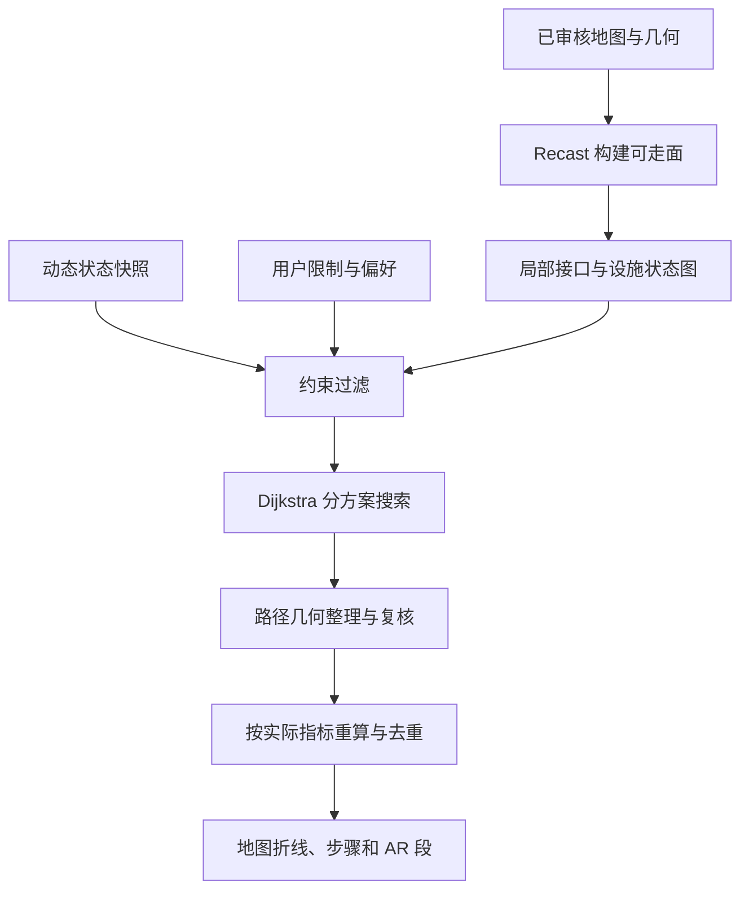

# 校园室内外 AR 导航后端完整设计 v1

日期：2026-10-12。状态：**总体导航方案已获认可，路线评价与推荐继续细化；尚未实现、部署或完成校园实测。**

本文件展开 DRD 的地图与寻路部分。手机客户端、定位算法和地图素材自动化导入由对应设计继续决定。本次明确导航内核的推荐组合、空间表达、约束、评价、接口及实现顺序。文中的性能与物理参数不冒充已测结果。

## 1．需求依据与研究范围

当前用户提供的校园事实是海拔起伏、少数石板与被踩烂草地混合的小路；指定用例包括多出口广场、楼梯、斜坡、电梯。其余边界是需要正确表达的通用情景，不代表已经调查到校园存在这些设施。

研究回答三件事：开放区域怎样避免出口完全图；不同地形、表面和连接怎样进入通行规则与评价；哪些现成实现能复用，哪些能力需要项目补齐。资料核验截至 2026-10-12，以第一方文档及源码为依据。**以下架构是本项目的设计判断，不是外部项目已经替我们实现的能力。**

## 2．推荐方案及复用边界

采用**已审核空间数据 → 可通行面与明确接口 → 稀疏有向状态图 → 约束过滤与偏好评价 → Dijkstra 搜索 → 三维几何复核 → 地图和 AR 指引**。

| 部件 | 本次推荐 | 复用内容与项目职责 |
| --- | --- | --- |
| 可通行几何 | Recast／Detour，稳定发布基线 v1.6.0 | 复用网格构建、空间查询、多边形连接、廊道内路径整理和高度查询；项目负责真实通行语义、跨层接口及属性映射 |
| 全局搜索 | Boost.Graph 的有向图与 Dijkstra | 复用 C++ 搜索实现；项目构造非负代价的扩展状态图。与几何库组成一个导航内核，不部署第二套路由服务 |
| 路线规则 | 项目维护的可解释规则 | 区分硬禁止、软偏好与优先级；借鉴 PPR、OpenSidewalks／OSM 的字段语义，保存物理事实与证据 |
| 多方案 | 按用途分别搜索，去重后展示最多 3 条 | 默认比较预计较快、省力易走，以及用户启用的无楼梯约束方案；没有实质区别时只展示已有不同路线 |
| A* | 后续经下界与性能验证再启用 | v1 全局搜索用 Dijkstra，避免电梯与混合代价使启发函数高估；不是把算法名称等同于速度保证 |

Recast／Detour 是独立 C++ 工具集，不要求客户端使用 Unity；发布页确认 v1.6.0，许可证为 zlib。Boost.Graph 提供可复用的图与 Dijkstra／A* 算法，采用 Boost Software License。实施时锁定 Boost 实际稳定版本及导航构建配置。[Recast Navigation](https://github.com/recastnavigation/recastnavigation)（访问：2026-10-12；可信度：高）、[Recast releases](https://github.com/recastnavigation/recastnavigation/releases/tag/v1.6.0)（访问：2026-10-12；可信度：高）、[Boost Graph](https://www.boost.org/doc/libs/latest/libs/graph/doc/html/graph/algorithms/shortest_paths/shortest_paths_overview.html)（访问：2026-10-12；可信度：高）、[Boost license](https://www.boost.org/LICENSE_1_0.txt)（访问：2026-10-12；可信度：高）。

服务器调度可沿用 DRD 的 Python 候选：一个薄的 C ABI 适配层通过 Python `ctypes` 调用由 Recast／Detour 和 Boost.Graph 组成的 C++ 导航内核，返回几何与完整路线。该适配层和领域规则需要实现，不能称现成的完整校园导航包。内核执行边代价与状态搜索，避免跨语言逐边回调。若后端语言另行改变，导航数据与接口契约仍适用。每个请求使用独立查询上下文，已发布几何与基础图只读共享；不共用可变搜索缓冲。

与另一会话的离线能力讨论衔接：v1 在服务器执行该内核。以后若决定在手机本地重规划，可评估编译同一 C++ 内核和分发同版本规则／地图；不能自动承诺已完成 Android 集成，也不能把离线寻路当作已解决离线定位。已缓存路线的步骤查看可独立于离线重规划。该结构也避免把服务器 Python 专用图模型作为客户端必须复制的另一套规则。

### 为什么没有直接采用一整套人行导航引擎

| 已调查项目 | 已核实有用的能力 | 本次未选为完整内核的原因 |
| --- | --- | --- |
| Valhalla 3.9.1 | 已发布的广场面穿越、内部障碍和稀疏骨架；室内楼层与电梯相关处理 | 合成广场边的属性与硬约束仍需核对补齐；源码中的部分轮椅坡度检查被注释。骨架路线不等于连续空间精确最短路径 |
| PPR 当前 master | 步行专用规则、上下楼／坡度、允许／惩罚／禁止、Pareto 寻路 | 路面字段存在不等于已进入代价函数；区域实现使用可见图和局部矩阵，Floyd–Warshall 预计算会随局部节点数增长 |
| GraphHopper 11.1 | 对既有边的路面、坡度、速度、偏好和转向代价进行配置 | `areas` 修改既有边，并不自动生成广场自由穿越路径；仍需补校园空间和设施模型 |
| OpenSidewalks Schema | 显式拓扑、路径／路缘字段、数据来源与时间 | 是数据语义参考；其 Zone 定义为门户完全图，不能原样作为广场扩展方案 |

以上判断对应 [Valhalla pedestrian areas](https://github.com/valhalla/valhalla/blob/3.9.1/docs/docs/concepts/pedestrian-areas.md)、[Valhalla pedestrian cost](https://raw.githubusercontent.com/valhalla/valhalla/3.9.1/src/sif/pedestriancost.cc)、[PPR area routing](https://github.com/motis-project/ppr/blob/master/include/ppr/common/area_routing.h)、[PPR costs](https://github.com/motis-project/ppr/blob/master/src/routing/costs.cc)、[GraphHopper custom models](https://github.com/graphhopper/graphhopper/blob/11.1/docs/core/custom-models.md)、[OpenSidewalks Zones](https://github.com/OpenSidewalks/OpenSidewalks-Schema#zones)（均访问：2026-10-12；对所述文档／源码行为的可信度：高）。PPR 的 master 分支和 OpenSidewalks 草案可能变化；实施时记录实际采用的提交，不以移动分支作为依赖锁定。

不同时拼接多个人行导航服务。维护一套权威校园地图、通行规则、搜索结果和 AR 几何，减少不同引擎吸附到不同楼层或采用不同限制的风险。

## 3．需要覆盖的边界情况

下表是设计覆盖范围。P0 表示涉及连通性和可行性，存在时必须正确处理；P1 表示影响用户限制或路线体验；P2 表示有额外可信数据时才启用的情景。

| 级别 | 情景 | 记录及路由处理 |
| --- | --- | --- |
| P0 | 广场、大厅、庭院、多出口及内部花坛／喷泉／柱子 | 审核后的可走面、孔洞、线障碍、接口；从起点在面内寻路，绕开障碍，不默认出口之间直连 |
| P0 | 靠得很近却隔着墙、栏杆或高差的区域 | 按实际门／开口／过渡连接；边界接触和图上距离近都不产生连接 |
| P0 | 广场或小路被车行道路切开 | 拆分步行面，只经审核过街接口连接；不把整片地面视为任意可穿越 |
| P0 | 连廊、桥、地下通道和楼层投影重叠 | 独立空间身份和高度；仅通过明确连接换层，投影交叉不相连 |
| P0 | 门禁、闸机、单向门、身份限制、开放时段 | 原始规则、方向、身份与时间条件；不满足时过滤，不以惩罚代替禁止 |
| P0 | 目的地有多个入口或入口在另一层 | 目的地绑定可进入的入口；按入口集合搜索，不能把房间中心或建筑中心作为任意可达点 |
| P0 | 起点不确定、吸附到墙后或另一层 | 先约束空间／楼层，再做距离和连通性检查；歧义时请求确认，不静默跳到最近节点 |
| P0 | 封路、围挡、设施停运、动态状态过期 | 来源和有效期独立于地图；禁止相关连接或阻挡几何，重算；过期不能直接认定恢复开放 |
| P1 | 连续海拔起伏、短陡坡、先上再下 | 高度剖面、方向、局部纵坡、累计上升下降；不只看端点高差或平均坡度 |
| P1 | 横坡、路缘石、门槛、单独一级台阶 | 独立阶差与横坡属性，必要时明确绕行口；无整段楼梯不代表可通过 |
| P1 | 石板＋草地、泥土、碎石、裂缝、缺板或松软地面 | 材质与状态分开，分段或划分表面区域；记录平整度、缝隙、高差及最窄净宽 |
| P1 | 被踩出来的小路／草坪捷径 | 路径形状、非正式程度与通行许可分别审核；有人走过不证明允许通行 |
| P1 | 狭窄门口、柱子、车挡、转弯空间不足 | 使用瓶颈净宽、净高与转弯空间；普通路宽不能替代实际最窄开口 |
| P1 | 楼梯、坡道、扶梯、电梯及停靠层不同 | 方向、起止空间、物理剖面、运行状态；扶梯不自动等同无障碍坡道，电梯只在实际出口换层 |
| P1 | 从不同方向看同一岔路／入口容易混淆 | 以“进入接口→离开接口”记录辨路因素，绑定观察来向与证据 |
| P1 | AR 跟踪不稳、地图对齐未知 | 与步行可达性分开；不确定时停止确定性空间指引，保留有效文字步骤 |
| P2 | 雨后湿滑、积水、临时人流 | 仅使用核实事件或明确标注的用户情景；没有事件来源时不生成实时结论 |
| P2 | 夜间照明、遮雨偏好、临时出口变化 | 记录已核实设施与规则；不把“有灯／有顶棚”直接等同当前亮灯／完全避雨 |

字段语义参考 [OSM pedestrian navigation](https://wiki.openstreetmap.org/wiki/Guidelines_for_pedestrian_navigation)、[OSM indoor tagging](https://wiki.openstreetmap.org/wiki/Simple_Indoor_Tagging)、[OSM surface](https://wiki.openstreetmap.org/wiki/Key:surface)、[OSM smoothness](https://wiki.openstreetmap.org/wiki/Key:smoothness)、[OSM access](https://wiki.openstreetmap.org/wiki/Key:access)（均访问：2026-10-12；对标签自身语义的可信度：高）。本表的组合与处理策略是项目设计，不是声称这些标签能自动生成完整路网。

## 4．权威地图数据与坐标

### 数据对象

| 对象 | 必需内容 |
| --- | --- |
| `Space` | 建筑／室外区域、唯一空间 ID、唯一 `level_id`、显示楼层名、局部坐标变换 |
| `WalkSurface` | 可走面的外环与孔洞、几何／高度来源、空间身份、表面区域、审核状态 |
| `PathSegment` | 三维折线与高度采样、两端明确接口、材质变化、方向、权限、瓶颈与证据 |
| `Portal` | 穿越边界的位置或开口、两侧空间、净宽／阶差、方向、进入条件 |
| `Connector` | 楼梯／坡道／扶梯／电梯／过街连接；明确端口、状态及物理参数 |
| `Destination` | 目的地及可进入的入口集合；入口可有不同身份或时间条件 |
| `DecisionTransition` | 来向、去向、标识证据、辨路因素、提示事实；不是任意网格转弯都收费 |
| `Evidence` | 来源素材／测量、观测时间、审核者和审核状态，关联具体事实 |
| `StateOverlay` | 受影响对象或空间几何、开放／关闭／未知、有效时间、来源与版本 |

所有事实保留未知值。未知坡度不转成 0，未知净宽不转成无限大，未知候梯不转成免费，未知开放时段不转成全天开放。方向、单位和测量来源不能省略。

内部采用米制校园局部坐标：`x` 向东、`y` 向北、`z` 向上。地图保存原点、坐标参考与高度基准。Recast 的水平 `x/z`、竖直 `y` 在适配层显式转换；不在客户端猜轴顺序。经纬度用于地理关联，不能直接当米制距离参与搜索。

楼层身份与高度分别存：显示为一层的空间可以有不同绝对高度，室外地面也会起伏。不同空间即使几何靠近，也只有审核接口才能连接。地图与 AR 的坐标变换带版本；导航接口接收已对齐的地图位置及不确定度，不替代定位设计。

### 海拔与混合地面的表达

坡度保存为有方向的 SI 比值 `Δz / 水平距离`，展示百分比时明确转换。高度折线保留分段上升／下降和最大局部坡度；开放面使用高度三角面及其梯度，依实际行走方向计算纵坡与横坡，不能为整片山坡只存一个平均值。OSM `incline` 导入时保留其陡段最大坡度语义，不能当端点平均值。[OSM incline](https://wiki.openstreetmap.org/wiki/Key:incline)（访问：2026-10-12；可信度：高）。

石板＋草地小路优先记录为具体路径与表面分段；无法分辨时记为混合且状态未知，不扩张成整片草坪可任意穿越。材质、平整度、松软程度与许可是不同属性；规则格网透水铺装的 `grass_paver` 不能直接代指用户描述的散布石板和草地。[OSM surface](https://wiki.openstreetmap.org/wiki/Key:surface)（访问：2026-10-12；可信度：高）。

## 5．广场与开放区域：网格、接口和复杂度

NavMesh 是把可走面划分成相邻的凸多边形。障碍是可走面中的孔洞或不可穿越边界；门口和广场出口是有语义的接口。Recast 接受几何三角面生成网格，不能直接从普通视频保证生成正确的校园通路。二维审核图可以按已知高度构造三角面，不要求先完成整栋楼的照片级三维重建。[Recast Navigation](https://github.com/recastnavigation/recastnavigation)（访问：2026-10-12；可信度：高）。

构建流程：

1. 在每个明确空间中划出审核可走面，扣除障碍，按材质和重要高度／坡度变化切分。
2. 按通行净空生成网格，保存面与原始事实的对应关系。道路、禁止草坪与未审核区域不进入可走面。
3. 为相邻多边形的共享开口生成局部通行接口；跨空间连接只使用审核 `Portal`。
4. 构造稀疏通行图：接口代表点只连接同一凸面内的局部接口、相邻面的对应接口，以及语义设施节点。出口接入所在面，不预先生成所有出口对之间的路线。
5. 一个面聚集过多出口时局部细分，保持每个面的局部连接数有界；几何网格与出口连接可离线生成，用户起终点临时接入。

接口代表点采用开口中点与经净空收缩后的边界代表点；分辨率按几何误差预算调整。局部面内路径必须经过高度采样和约束检查。**这些离散代表点会影响路线质量，是近似空间模型，不能宣称自动求得任意异质地形上的连续空间全局最优路径。**

设多边形数为 `P`、每面局部接口代表点数上限为 `b`、语义接口数为 `K`。局部连接构建按 `O(P·b² + K)` 组织；在 `b` 有界且接口局部细分的前提下，不需要整个广场的 `O(K²)` 出口完全图。几何越复杂、属性切分越细，`P` 仍会增长；不存在不受场景影响的固定复杂度保证。

例如广场有 100 个出口，完全图产生 4,950 对连接，但给出口定义端点本身只有线性数量。方案将出口接入局部可走面；实际网格规模取决于障碍、边界和地面变化，而不是硬性预计算 4,950 条广场路径。OpenSidewalks 的 Zone 正是完全图语义；本项目仅借用其数据词汇。[OpenSidewalks](https://github.com/OpenSidewalks/OpenSidewalks-Schema#zones)（访问：2026-10-12；可信度：高）。

网格在空间／区域内构建，跨层只通过接口接通。地面与桥面在投影上重叠不会自动相连。高度和净空不满足时，即使渲染上可见，也不能成为通路。

## 6．硬约束、状态与用户配置

查询先过滤，再优化。硬禁止包括不允许的身份／方向、确认关闭、禁止楼梯、超出用户明确能力的坡度／阶差／净宽，以及未审核通行连接。硬禁止不会因为绕行很远而被自动放宽。

用户配置分为：

- **普通步行**：使用已审核、允许行人经过的拓扑；未测的非关键物理属性标明未知，不自动称为平整或易走。
- **避免楼梯**：过滤楼梯及已记录的单独台阶；未知阶差导致无法确认，而不是“已验证无楼梯”。
- **按明确能力约束通行**：净宽、纵坡、横坡、阶差、路面和转弯要求均检查，关键未知返回无法确认。只能描述所核实的能力条件，不使用泛化的无障碍认证标签。
- **软偏好**：省力、平整、少辨认、优先电梯；通过排序代价体现，不生成隐藏硬限制。

“无楼梯”不等于轮椅可达；OSM 也要求轮椅可达性有明确依据。[OSM wheelchair](https://wiki.openstreetmap.org/wiki/Key:wheelchair)（访问：2026-10-12；可信度：高）。初期不设未经校园实测和适用需求确认的轮椅坡度／净宽阈值。

状态覆盖使用独立 `state_version`。已知封路先阻断对应边；广场新增围挡若切断一个多边形内部，必须在查询几何中扣除障碍并局部重建或精确校验连接，不能只封出口或增加惩罚。过期状态回到未知／已审核基线，由状态规则处理，不能从“关闭消息过期”推导当前开放。

时段限制连接在 v1 采用保守静态策略：请求携带最大行程时间，或采用明确展示的产品规划有效窗口；只有规则证明在该整个窗口持续允许通过的连接才纳入搜索。窗口缺失或设施等待未知而无法界定通过范围时，严格查询返回无法确认，不能默认为可用。结果还要按出发时刻和累计预计通过区间复核；超过窗口或状态已变化则重算。v1 不做等到门开放的精确时刻最优规划。此策略可能排除实际能够通过的短时开放连接，最优性限于保守快照，不等同所有可能等待策略的最优解。

## 7．路线代价与可解释的推荐

为每个方案使用非负、可累加的代价：

```text
C(route) = Σ 预计通过时间
         + λ_up × 累计上升
         + λ_down × 下行负担
         + λ_surface × 路面负担积分
         + λ_decision × 实际辨路决策负担
         + λ_uncertain × 可接受的非关键数据不确定负担
```

各系数把对应负担转换成统一的偏好代价单位；硬约束的缺失证据不能通过不确定性惩罚绕过。将路段拆成更多小段不会凭空提高费用：距离、爬升与路面按长度／高度积分，决策和登梯仅在对应真实事件计费。

预计通过时间由路段长度、坡度／材质对应速度、真实事件的估计等待等组成；未测时使用明确标注的模型估计。体力惩罚不是实际耗时，辨路评分也不冒充固定停顿秒数。默认“较快”方案最小化预计时间；“省力易走”使用经配置的偏好代价；用户的禁止条件应用于所有方案。

未校准的省力／辨路系数使用有版本、注明为实验偏好的配置。它们可以参与模拟比较，但不能据此宣称真实省力收益已成立。显示原始指标，让用户知道推荐因何产生。

### 电梯、扶梯与来向状态

电梯建模为 `候梯厅 → 登梯 → 梯内各停靠层状态 → 出梯口`。登梯边计一次候梯及登梯事件，梯内相邻实际停靠层状态连接，连续乘坐不重复候梯；出口只出现在真实允许离开的层。`F` 个停靠层采用约 `O(F)` 的梯内链和登／出梯边，不预先建立所有楼层对电梯边。预计停靠耗时仅是当前静态模型，不声称已知实时调度。

状态可以是 `接口代表点＋进入方向／语义来向＋行走或某部电梯内`。楼梯与斜坡的正反方向分别计价；辨路代价只在真实岔路或接口转换处计算。这样来向相关费用在扩展图中成为固定非负边费用，基础搜索不需要猜历史。

## 8．搜索、几何整理与最优性范围



查询流程：

1. 固定地图、状态与参数版本；核对起点空间和目的地入口。
2. 接入临时起终点；未能确认正确空间时返回需要确认位置。
3. 构造当前配置的约束视图和状态边代价，分别进行 Dijkstra 搜索。
4. 将状态路径还原为明确空间中的几何廊道和设施转换。
5. 在适用的同一层／同一空间廊道中复用 Detour `findStraightPath` 做路径整理，并以高度查询补齐地形起伏。
6. 重新检查整个折线的障碍、通行面、材质、最大坡度、净空、状态与时段；重新计算距离、时间和排序指标。
7. 去重后输出不同用途的路线，附每条路线的推荐原因和未确定信息。

Detour 的路径整理是在**给定多边形廊道**中进行，官方称为 string pulling；它不证明异质路面或额外偏好下的全空间最优。其 raycast 是有使用限制的二维检查，不能用来判断重叠楼层之间可直连。[Detour query](https://recastnav.com/classdtNavMeshQuery.html)（访问：2026-10-12；可信度：高）。

异质地面或方向费用下，整理后的折线若改变真实指标，则重新排名；若增加偏好代价或不满足约束，保留原来的已验证代表点折线，而不是强制拉直。即使几何整理降低费用，也只承诺改善已产生候选，不承诺找到了连续空间的全局最优。不可跨材质边界丢弃指标，不可把坡道／楼梯／电梯转换直接平滑成空中直线。

### 搜索复杂度与限制

普通 Dijkstra 常见堆实现为 `O((V+E) log V)`；来向状态展开后的实际 `V/E` 才是性能测量对象。局部连接有界和设施节点稀疏可以控制规模，但高度复杂的几何与瓶颈会增加状态数量。[Boost Graph](https://www.boost.org/doc/libs/latest/libs/graph/doc/html/graph/algorithms/shortest_paths/shortest_paths_overview.html)（访问：2026-10-12；可信度：高）。

v1 求每个已配置单目标的图上最优路径，不枚举所有简单路径、不求全体 Pareto 前沿，也不把距离前 K 条当作所有舒适方案。开启 A* 时先验证与总代价同单位的全模式下界；无法证明下界则用零估计。A* 的最优性依赖有效启发函数；不能在电梯可快速换层时随意使用“直线距离除以步行速度”。[Boost Graph A*](https://www.boost.org/doc/libs/latest/libs/graph/doc/html/graph/algorithms/shortest_paths/astar_search.html)（访问：2026-10-12；可信度：高）。

不直接把以秒为单位、含电梯速度的全局代价塞入 Detour 默认 A*。它的默认过滤代价与距离相关，官方说明小于 1 的代价修正可能引起问题；全局偏好搜索由状态图负责。[Detour filter](https://recastnav.com/classdtQueryFilter.html)（访问：2026-10-12；可信度：高）。

图上最优、廊道内几何整理、模型预计时间和真实体验是四种不同结论。v1 只保证已审核地图和当前约束下，返回经几何复核的路线；离散模型误差和时间估计依据随结果记录。

## 9．导航接口与 AR 输出

输入包含：`map_version`、起点地图坐标／空间／楼层／位置不确定度、目的地 ID 或入口集合、出发时刻、最大行程时间／规划有效窗口、用户硬限制、方案偏好。服务决定并回显 `state_version` 和 `profile_version`；不接受未经校验的跨地图坐标。

每条结果至少包含：

| 字段 | 含义 |
| --- | --- |
| `route_id` 与各版本 | 标识所使用的地图、状态、偏好和坐标变换 |
| `segments` | 三维地图坐标折线，按空间、楼层、设施动作分段；附原始地图对象 ID |
| `steps` | 目的地入口、转向、登梯／出梯／上下楼等动作；提示依据是已审核事实 |
| `metrics` | 实际折线长度、预计时间及依据、累计上升下降、路面分布、辨路因素、未知信息 |
| `ranking` | 配置方案、排序代价与推荐原因；不与预计耗时混合 |
| `geometry_quality` | 地图位置／高度来源、离散精度配置、路径整理及复核状态 |
| `state_validity` | 状态观测时间、适用区间与需复核的设施 |

结果状态区分：`ok`、`needs_position_confirmation`、`no_route_under_constraints`、`insufficient_map_evidence`、`stale_map`、`computation_limit`。关键未知与已知不可达不能混成同一种错误；计算资源不足不返回假装到达终点的部分路径。适配层检查 Detour 的详细状态标志和终点是否真正到达；`DT_SUCCESS` 不能覆盖 `DT_BUFFER_TOO_SMALL`、`DT_OUT_OF_NODES` 或部分路径信息，缓冲不足时有界重试或返回计算限制。

AR 沿各个行走段渲染，经地图与 AR 坐标变换放入真实空间。乘梯阶段输出“到指定层后出梯”等动作，不在竖井里画可行走的箭头。路线采样密度仅影响显示，不反过来增加全局寻路节点。

手机跟踪／渲染持续进行；后端在确认偏航、目的地或限制改变、状态改变时重算。服务端延迟结果与请求位置、时间、地图版本关联；客户端检查适用性，不能把旧请求的起点当成当前精确位置。失去跟踪／对齐时停止确定性空间指引，恢复流程由定位设计提供。

## 10．参数、性能和可恢复更新

| 参数组 | 内容 | 确定方式 |
| --- | --- | --- |
| 原始空间参数 | 实际路径、高度、净宽、阶差、路面与许可 | 素材、测量或模拟输入，保留来源；不从算法默认值伪造事实 |
| 网格配置 | `cs/ch`、净空、轮廓简化误差、细节高度采样、接口采样密度 | 在最窄开口、最小关键阶差和已知高度案例上确定误差预算；记录实际构建配置 |
| 用户限制 | 禁台阶、净宽、纵坡、横坡、路面条件、关键未知政策 | 用户明确能力／用途与已核实要求；不同净空需求必要时生成独立网格配置 |
| 偏好／时间模型 | 速度、候梯估计、路面负担、爬升与辨路系数 | 明确为模型参数，版本化；校园验证后校准 |
| 产品配置 | 去重后最多 3 条、启用的方案类别 | 本提案的默认展示上限，可按产品反馈调整 |
| 查询资源 | 超时、节点池、几何缓冲与并发上限 | 部署机器和代表性路网上实测后设定；不足时明确返回计算限制 |

Recast 的网格配置涉及水平／竖直体素、净空、可跨阶差及简化误差；构建时丢掉的窄通道不能靠查询时换个惩罚值恢复。[Recast config](https://recastnav.com/structrcConfig.html)（访问：2026-10-12；可信度：高）。

发布阶段离线构建并缓存基础图，查询阶段复用，避免每次从数据库重建整张图。缓存键包含地图、状态、网格配置与偏好版本；起点位置误差不能被不恰当的粗粒度缓存掩盖。tile／局部区域更新先重建受影响几何和接口，复核后原子切换版本；进行中的请求使用旧完整快照，客户端检查返回版本是否仍适用。

动态围挡没有完成局部重建时，可保守排除受影响可走面并改道；存在通路却暂时无法证明时返回信息不足，不沿旧路线穿过围挡。临时行人不当作需要持续重建地图的静态障碍；实时拥堵与相机避障没有可信输入时不启用。

性能核验记录基础图与状态图的节点／边数、构建耗时／峰值内存、每个方案查询耗时、几何整理耗时、端到端 P50／P95 及并发。另记录相对高精度参考路径的几何绕行和代价偏差。先测广场接口增加、复杂孔洞、跨层和混合路面的代表场景；本提案不宣称已达到具体毫秒数。

## 11．实施顺序与核验重点

1. **空间与数据模型**：用模拟素材建立广场、丘陵折线、混合小路与跨层结构；证据、身份、楼层、方向先正确。
2. **几何与图**：集成 Recast／Detour，导出局部接口图；复用 Boost.Graph Dijkstra；完成正确空间中的起终点接入和路径复核。
3. **规则与多方案**：加入硬过滤、用户限制和可解释偏好；用电梯状态避免重复候梯，辨路事件避免网格切分重复计费。
4. **AR 契约与状态**：输出分段三维折线、动作和版本；与另一会话的定位／坐标对齐设计集成；处理关闭与重算。
5. **代表性核验后校准**：确认几何误差和资源配置，再确定实际体验系数与响应目标；对真实校园数据和手机分别验证。

后续实现需要证明的重点是：多出口且有障碍的广场不穿越禁区；同高端点的起伏路保留累计爬升；混合路面与阶差能改变过滤／推荐；跨层电梯只连接实际出口且只计一次登梯；新围挡、过期状态、未知关键属性不会产生假确认；AR 折线在对应空间内，丢失对齐时按定位协议处理。这里规定需要证明的行为，没有添加 CI、测试框架或测试数量指标。

## 12．当前未验证的部分

完整的是本次导航设计，不是校园建图或运行成果。尚缺实际路网与几何规模、分段高度／路面／净宽测量、通行许可及开放规则、设施等待和状态来源、真实速度／偏好校准、部署性能及手机地图对齐结果。

当前输出可作为导航模块实施依据。真实资料补齐前使用明确标注的模拟数据；未知关键约束返回信息不足。精确连续空间多目标最优、实时电梯调度、人群避障、雨后自动路况判断和泛化无障碍认证不在 v1 的已承诺能力中。
